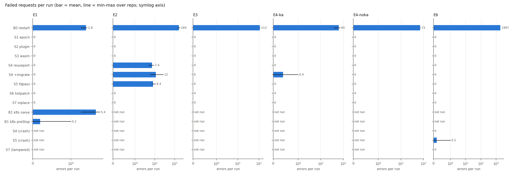
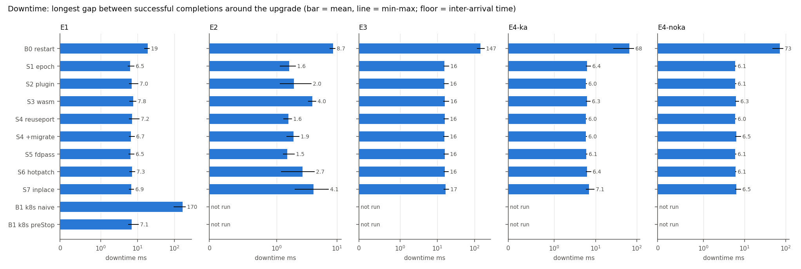
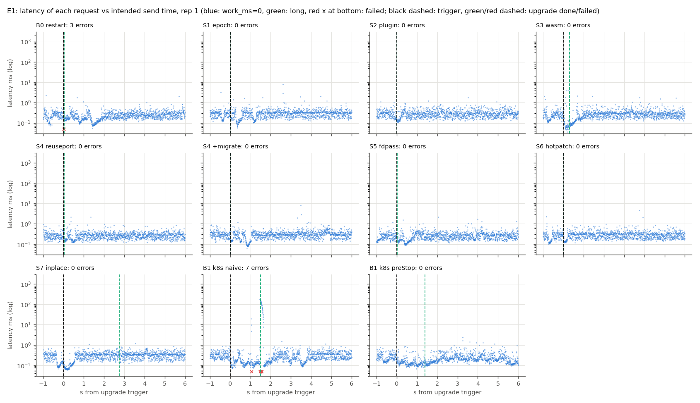
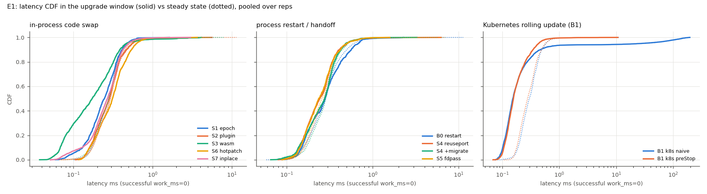
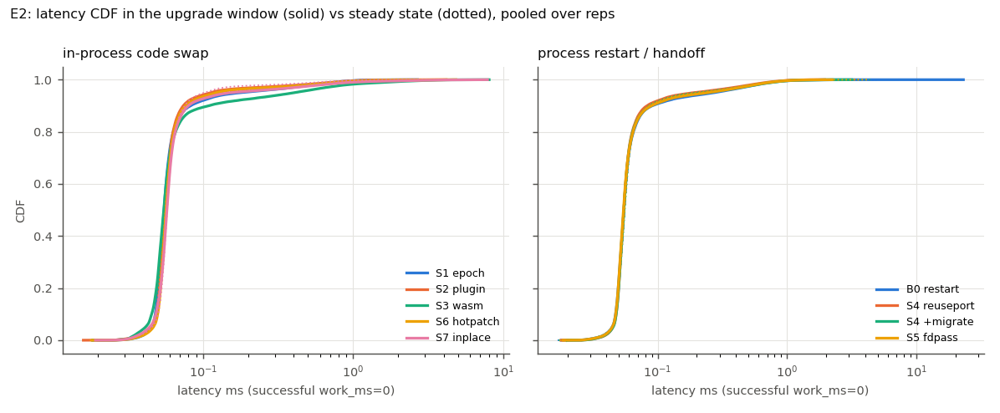
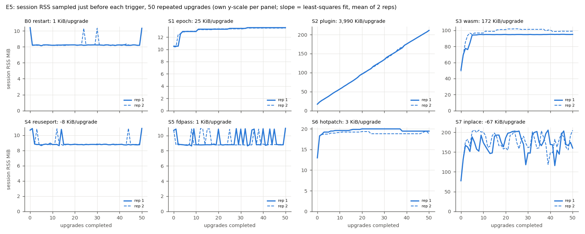
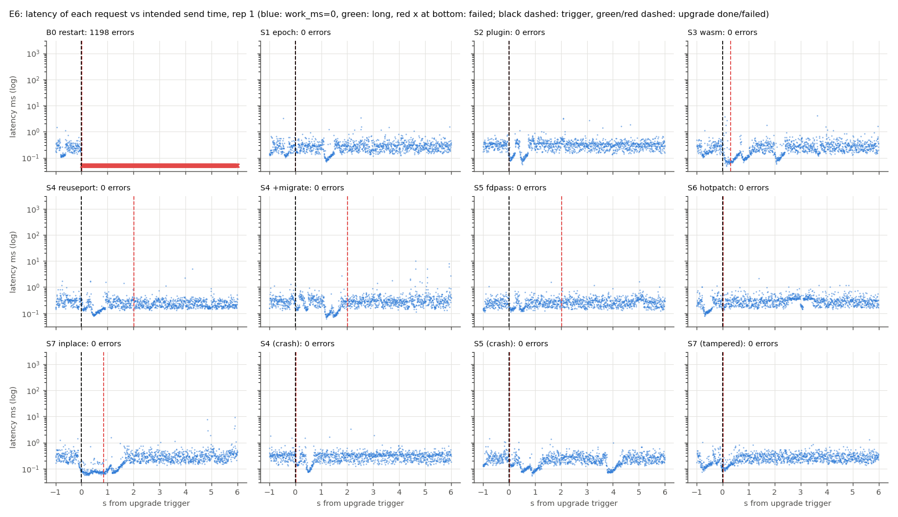

# Results: Zero-Downtime Upgrades of a Stateful Go Microservice

## 1. Setup

**What was measured.** Eight implementations of the same contract service
(`docs/CONTRACT.md`) plus the Kubernetes rolling-update baseline, all measured
through one black-box harness (`bench/`, `scripts/`). Metric definitions:
`docs/evaluation-methodology.md` section 4. Every number below comes from the
final campaign of 2026-11-08 (`RUN_TAG=final`). Per-run metrics are in
`results/summary_runs.csv`, aggregates in `results/summary.csv`, and the
generated tables in `results/summary.md` and `results/report_tables.md`.

| Label | Mechanism | How v1 -> v2 is delivered in the harness |
|---|---|---|
| `b0-naive-restart` | stop the listener, drain, start the new binary (baseline) | `?bin=./server-v2` (separately linked binary) |
| `s1-epoch-swap` | in-process swap, per-version refcount draining; v1/v2 compiled in | `?to=v2` |
| `s2-plugin` | Go `plugin` (.so) loaded at runtime, published via S1's registry | `plugins/v2.so` |
| `s3-wasm` | WASM module (wazero, compiler), unloaded after drain | `modules/v2.wasm` |
| `s4-reuseport` | new process binds a second `SO_REUSEPORT` socket, state handed over a unix socket | `?bin=./server-v2` |
| `s4-reuseport+migrate` | as S4, container started with `net.ipv4.tcp_migrate_req=1` | as S4 |
| `s5-fdpass` | listening socket passed to the new process (`SCM_RIGHTS`), state handed over | `?bin=./server-v2` |
| `s6-hotpatch` | hotpatch-ready compilation: signed plugin patch set, one transaction, per-request pinning | `plugins/v2.so` + signed manifest |
| `s7-inplace` | signed WASM bundle, in-process shadow -> canary 1/10/50 % -> promote (`FastStrategy`) | pre-staged signed bundle `bundles/v2` |
| `k8s-naive`, `k8s-prestop` (B1) | Deployment rolling update of the mock server, 3 replicas, `maxSurge=1,maxUnavailable=0`, readiness 1 s; prestop adds `preStop: sleep 5` | `kubectl set env VERSION=v2` |

Per-solution integration (build, generations, failure injection) is declared in
`cmd/<sol>/bench.env`; section 6 lists the choices that matter for
interpretation.

**Testbed.** Apple M4 Pro (12 cores, 24 GiB), macOS; Docker Desktop 28.5.1
Linux VM (12 vCPU, 7.65 GiB, kernel 6.10.14-linuxkit, arm64). Bench container
`dimp-bench` (`golang:1.25`, Go 1.25.14, Debian 13) with `--cpuset-cpus 0-5
--cpus 6 --memory 4g`, `SYS_PTRACE`, unconfined seccomp, `somaxconn=4096`,
`tcp_tw_reuse=1`. Inside the container the server runs on CPUs 0-1 and
loadgen + RSS sampler on CPUs 2-5 (`taskset`); client and server talk over
loopback. B1 ran in a kind cluster (single node container pinned to host CPUs
0-5, in-cluster loadgen Job through the ClusterIP Service). No other
containers were running during the campaign (`docker_other_containers_at_start=0`
in every run's `metadata.json`). Git SHA of the measured code:
`464cd1f71483e4b549f157d352b304beb6f55da9`; the working tree was dirty only
with the benchmark integration added for this campaign (`cmd/*/bench.env`,
`scripts/`, `bench/`), no solution source was modified.

**Workload.** Open-loop constant-rate client (latency measured from the
intended send time, no coordinated omission, no transparent retries). One
upgrade trigger at t = 10 s, 10 s tail, first 3 s excluded.

| Exp | Purpose | Rate req/s | Mix (work_ms:share) | Keep-alive | Upgrades | Reps |
|---|---|---|---|---|---|---|
| E1 | baseline | 200 | 0:1 | on | 1 | 5 |
| E2 | near saturation | 21 000 (common, see 1.1) | 0:1 | on | 1 | 5 |
| E3 | long requests | 200 | 0:0.9, 500:0.1 | on | 1 | 5 |
| E4-ka / E4-noka | connection handling | 500 | 0:0.95, 100:0.05 | on / off | 1 | 5 each |
| E5 | repeated upgrades, memory | 100 | 0:1 | on | 50, every 2 s (S7: every 15 s) | 2 |
| E6 | failed upgrade, rollback | 200 | 0:1 | on | 1 to a failing target | 5 |
| B1 | k8s rolling update, E1-equivalent | 200 | 0:1 | on | 1 (tail 40 s) | 5 per variant |

### 1.1 E2 rate calibration

`scripts/calibrate.sh` swept 4 000 ... 64 000 req/s (8 s per step, no
upgrade); a step passes with zero errors and p99 < 50 ms. Raw sweep:
`results/calibration/sweep.log`, per solution `results/calibration/<sol>.csv`.

| Solution | last passing step (req/s) | p99 there (ms) | first failing step: p99 (ms) | E2 rate as % of last passing |
|---|---|---|---|---|
| s1-epoch-swap | 32 000 | 1.01 | 40 000: 96.7 | 66 % |
| s2-plugin | **28 000** | 0.92 | 32 000: 96.8 | **75 %** |
| s3-wasm | 40 000 | 0.97 | 48 000: 80.5 | 53 % |
| s6-hotpatch | 32 000 | 1.09 | 40 000: 92.8 | 66 % |
| s7-inplace | 40 000 | 0.94 | 48 000: 104.7 | 53 % |
| b0-naive-restart | 40 000 | 1.13 | 48 000: 97.6 | 53 % |
| s4-reuseport | 32 000 | 37.7 | 40 000: 102.2 | 66 % |
| s5-fdpass | 28 000 | 0.89 | 32 000: 80.6 | 75 % |

No step had errors; every failure was the p99 criterion. `s4-reuseport+migrate` was not calibrated separately (same binary as S4).

The knee is between 28 000 and 48 000 req/s for every solution and is
abrupt (p99 jumps from ~1 ms to ~100 ms in one step), i.e. it is set by the
2-CPU server budget and the loopback/HTTP stack rather than by the upgrade
mechanism; differences of one grid step are within run-to-run noise (single
8 s run per step). We therefore used one **common E2 rate of 21 000 req/s =
75 % of the weakest in-process solution (S2, last passing step 28 000)**, so
every solution sees the same offered load.

## 2. Main comparison

E1 (200 req/s, keep-alive, one v1 -> v2 upgrade, 5 reps each). Mean ± 95 % CI
half-width. "Errors" is the total over all runs (failed / measured requests).
"State preserved" = zero counter resets, regressions and duplicates in **every**
run of E1-E4 (25 runs per solution; B1: 5 E1 runs). "Rollback" = E6 runs with
`rollback_ok` (an `upgrade_failed` event, no response from the failing
version, zero errors).

| Solution | Errors | Downtime ms | p99 in upgrade window ms | Upgrade duration ms | State preserved | Rollback (E6) |
|---|---|---|---|---|---|---|
| b0-naive-restart | 14 / 17 000 | 19.4 ± 2.8 | 0.89 ± 0.41 | 13.3 ± 1.7 | no (counter reset in 25/25 runs) | 0/5 (outage, see 4.6) |
| s1-epoch-swap | 0 / 17 000 | 6.5 ± 1.2 | 0.61 ± 0.17 | 0.7 ± 0.6 | yes | 5/5 |
| s2-plugin | 0 / 17 000 | 7.0 ± 2.3 | 1.04 ± 0.54 | 9.0 ± 2.5 | yes | 5/5 |
| s3-wasm | 0 / 17 000 | 7.8 ± 1.7 | 1.63 ± 1.18 | 299.8 ± 2.8 | yes | 5/5 |
| s4-reuseport | 0 / 17 000 | 7.2 ± 2.6 | 0.77 ± 0.16 | 14.6 ± 1.8 | yes | 5/5 (hang), 5/5 (crash) |
| s4-reuseport+migrate | 0 / 17 000 | 6.7 ± 1.0 | 0.70 ± 0.08 | 14.5 ± 1.7 | yes | 5/5 |
| s5-fdpass | 0 / 17 000 | 6.5 ± 1.1 | 0.72 ± 0.07 | 11.8 ± 0.5 | yes | 5/5 (hang), 4/5 (crash) |
| s6-hotpatch | 0 / 17 000 | 7.3 ± 1.0 | 0.89 ± 0.32 | 15.5 ± 1.1 | yes | 5/5 |
| s7-inplace | 0 / 17 000 | 6.9 ± 1.0 | 0.70 ± 0.10 | 3 893 ± 2 877 | yes | 5/5 (buggy), 5/5 (tampered) |
| k8s-naive (B1) | 27 / 47 000 | 169.9 ± 52.6 | 126.6 ± 41.7 | 1 465 ± 71 (rollout) | no (per-pod counters) | not measured |
| k8s-prestop (B1) | 1 / 47 000 | 7.1 ± 2.3 | 0.70 ± 0.17 | 1 404 ± 48 (rollout) | no (per-pod counters) | not measured |

Reference for "downtime": the same statistic over the steady window
(`steady_max_success_gap_ms`) is 6.8-10.3 ms in E1 for all solutions, and the
floor is the 5 ms inter-arrival time. An E1 downtime of 6.5-7.8 ms is
therefore indistinguishable from steady-state gaps. B1 runs have more measured
requests per run (40 s tail).





Full per-experiment tables (p50/p99/p99.9/max, failure window, time to new
version, version-mix window, error classes): `results/report_tables.md` and
`results/summary.md`.

## 3. Errors per experiment (all runs)

| Solution | E1 | E2 (21 000 req/s) | E3 (10 % x 500 ms) | E4-ka | E4-noka | E5 (50 upgrades) |
|---|---|---|---|---|---|---|
| runs x measured requests per run | 5 x 3 400 | 5 x 357 000 | 5 x 3 400 | 5 x 8 500 | 5 x 8 500 | 2 x 10 500 (S7: 2 x 74 200) |
| b0-naive-restart | 14 | 843 | 565 | 326 | 365 | 117 |
| s1-epoch-swap | 0 | 0 | 0 | 0 | 0 | 0 |
| s2-plugin | 0 | 0 | 0 | 0 | 0 | 0 |
| s3-wasm | 0 | 0 | 0 | 0 | 0 | 0 |
| s4-reuseport | 0 | 37 | 0 | 0 | 0 | 2 |
| s4-reuseport+migrate | 0 | 58 | 0 | 2 | 0 | not run |
| s5-fdpass | 0 | 42 | 0 | 0 | 0 | 0 |
| s6-hotpatch | 0 | 0 | 0 | 0 | 0 | 0 |
| s7-inplace | 0 | 0 | 0 | 0 | 0 | 0 |

Error classes: B0 is dominated by `refused` (E1 12 of 14, E2 748 of 843, E3 563
of 565, E4-ka 326 of 326, E4-noka 362 of 365, E5 117 of 117); S4/S5 errors are `reset` and `eof` only.

## 4. Findings per research question

### 4.1 RQ1 Availability

* **The five in-process solutions (S1, S2, S3, S6, S7) produced zero failed
  requests in any run** (E1-E6, 165 runs, 9 854 400 measured requests in
  total; 1 904 000 per solution in the 25 runs of E1-E4), and their downtime never exceeded the steady-state gap statistic by
  more than a few ms (largest: E2, S3 4.0 ± 0.5 ms and S7 4.1 ± 2.3 ms vs. a
  steady gap of 2.6 and 2.4 ms).
* **Process handoff (S4, S5) is error-free at moderate load but not at high
  load with keep-alive.** E1, E3, E4-ka, E4-noka: 0 errors for S4 and S5 (one
  exception: S4+migrate 2 errors in E4-ka). In E2 (21 000 req/s, keep-alive)
  every run of S4 (5-9 errors/run, 37 total), S4+migrate (6-27/run, 58) and
  S5 (7-11/run, 42) failed requests. All 137 of these failures were on **reused
  keep-alive connections** and fell within a ~3 ms band 8.6-12.3 ms after the
  trigger (S5 8.6-9.7 ms, S4 9.6-12.3 ms), i.e. at the handoff/seal instant,
  when the old process stops serving its idle keep-alive connections. They
  are the keep-alive close race (request written onto a connection the server
  is closing), not accept-queue loss.
* **`tcp_migrate_req=1` did not help in any experiment** (E2: 58 vs 37
  errors; CIs overlap). It migrates requests queued on a closing *listener*;
  the measured failures are on already-established keep-alive connections.
  In E4-noka (fresh connection per request, 500 req/s) S4 had 0 errors with
  or without it, so the accept-queue reset pitfall described in
  `docs/solutions/S4-so-reuseport.md` did not occur at this load (it needs a
  non-empty accept queue at close time; the doc reproduces it with an
  artificial 300 ms accept stall).
* **B0 (stop/start) fails in every experiment**, and the failure count scales
  with the time the port is closed: ~2.8 errors/run in E1 (19 ms downtime), 113
  refused/run in E3 (graceful shutdown waits for 500 ms requests: failure
  window 565 ± 10 ms), 65-73/run in E4 (failure window 130-146 ms with 100 ms
  requests).
* **B1 Kubernetes rolling update:** `k8s-naive` failed 2-7 requests per run
  (27 total, 26 `refused`), clustered 0.9-1.6 s after `kubectl set env`, when
  old pods were terminated before kube-proxy removed them; `k8s-prestop`
  removed this (1 `eof` in 5 runs, 6.4 s after the trigger, consistent with an
  old pod finally exiting after its 5 s preStop).

### 4.2 RQ2 Latency

* At 200-500 req/s no solution except B1-naive changed tail latency
  measurably: p99 in the upgrade window was 0.20-2.24 ms for all solutions in
  E1/E3/E4, with CIs overlapping the steady-state p99 (0.2-0.8 ms). k8s-naive
  is the exception: p99 126.6 ± 41.7 ms and max 163 ± 52 ms in the upgrade
  window: the E1 timeline shows a burst of requests issued ~1.5 s after the
  trigger that completed with up to ~180 ms latency, at the same time as the
  refused requests. Why these requests stalled rather than failed (e.g.
  connection attempts to an endpoint being removed) was not instrumented and
  is unverified.
* The solutions that do work in the upgrade path show it in p99.9/max, not in
  errors: S3 (wazero compilation, ~300 ms of CPU on the 2 server CPUs) had the
  highest in-process p99 in the upgrade window in E1 (1.63 ± 1.18 ms) and E3
  (2.24 ± 1.31 ms) and the highest E2 p99.9 (4.02 ± 1.76 ms), together with S7
  (also wazero; E2 p99.9 3.48 ± 1.96 ms). These differences are within a few
  ms and the CIs overlap with the other in-process solutions.
* Max latency below ~10 ms is VM noise: the steady-state max was up to 11.5 ms
  in E1 runs with no upgrade activity.
* Surprising: for several solutions the upgrade-window CDF lies slightly
  **left** of (faster than) the steady-state CDF (see the E1 CDF; most visible
  for S3, whose latency dropped to ~0.07 ms during its compile, and for both
  B1 variants). Periodic latency dips of the same depth also occur in steady
  state in the timelines. A plausible but **unverified** explanation is that a
  busy server CPU does not enter idle states, removing wake-up latency; we did
  not instrument CPU idle states.







### 4.3 RQ3 State continuity

Counter resets / regressions / duplicates, summed over all runs (lost
increments in `results/report_tables.md`):

| Solution | E1 | E2 | E3 | E4-ka | E4-noka | E5 |
|---|---|---|---|---|---|---|
| b0-naive-restart | 5 / 0 / 6 970 | 5 / 0 / 733 558 | 5 / 0 / 6 418 | 5 / 0 / 17 155 | 5 / 0 / 17 118 | 100 / 0 / 19 879 |
| S1, S2, S3, S4, S4+migrate, S5, S6, S7 | 0 / 0 / 0 | 0 / 0 / 0 | 0 / 0 / 0 | 0 / 0 / 0 | 0 / 0 / 0 | 0 / 0 / 0 |
| k8s-naive | 21 / 2 / 10 181 | | | | | |
| k8s-prestop | 11 / 4 / 16 889 | | | | | |

* All in-process and handoff solutions kept the counter strictly continuous
  across every upgrade (also across 50 upgrades in E5 and across the failed
  upgrades of E6): no reset, regression or duplicate in any of their 269 runs.
* B0 lost the state on every upgrade (exactly one reset per upgrade: 5 in five
  E1 runs, 100 in two E5 runs with 50 upgrades each). B1 has per-pod state by
  construction; the client sees counters from 3-4 different pods interleaved.
* Lost increments (counter values never seen by the client) were nonzero only
  where requests failed (S4/S5 in E2: 3, 5, 2) or at the warm-up boundary (an
  identical 49 in E3 and 16 in E4 for S1, S2, S3, S4, S5 and S7, i.e. a harness
  artifact: long requests issued before the warm-up cut return counts inside
  the measured range).

### 4.4 RQ4 Resources (E5: 50 upgrades, 100 req/s, 2 runs)

| Solution | Upgrades done/failed per run | RSS steady MiB | RSS end MiB | Slope KiB/upgrade |
|---|---|---|---|---|
| b0-naive-restart | 50/0, 50/0 | 10.3 | 10.3 | 0.8 ± 12.3 |
| s1-epoch-swap | 50/0, 50/0 | 10.5 | 13.5 | 24.7 ± 39.2 |
| s2-plugin (50 distinct plugins) | 50/0, 50/0 | 17.1 | **211.1** | **3 990 ± 15** |
| s3-wasm | 50/0, 50/0 | 49.8 | 97.0 | 172 ± 83 |
| s4-reuseport | 50/0, 50/0 | 10.7 | 10.9 | -8.3 ± 1.3 |
| s5-fdpass | 50/0, 50/0 | 10.7 | 11.0 | 0.7 ± 114 |
| s6-hotpatch (toggle v2 / rollback) | 50/0, 50/0 | 13.0 | 19.1 | 3.0 ± 45.9 |
| s7-inplace (50 distinct bundles) | 49/0, 49/0 | 77.5 | 180.7 (115-205 sawtooth) | -67 ± 3 149 |



* **S2 grows linearly and without bound**: ~3.9 MiB per loaded plugin
  (17 -> 211 MiB after 50 upgrades, both runs on the same line). Go plugins
  cannot be unloaded; every new generation stays mapped.
* **S3 is flat after warm-up**: RSS rises from 50 to ~95-100 MiB over the first
  ~5 upgrades (wazero runtime/compiler caches, Go heap headroom) and then stays
  flat for the remaining 45 (fitted slope 172 KiB/upgrade, 23x smaller than
  S2). Unloading drained modules works.
* **S7 does not leak but has the largest working set**: RSS oscillates between
  ~115 and ~205 MiB with no trend (two modules plus shadow pools exist during
  each rollout; the Go GC reclaims them afterwards). The fitted slope is
  meaningless here (± 3 149 KiB). In E2 its steady RSS was 119 MiB vs 14 MiB
  for S1.
* S1, S6, B0, S4, S5 are flat (within ±0.1 MiB/upgrade). For S4/S5 the single
  spikes to ~11 MiB in the plot are samples taken while two processes
  coexisted; with 100 ms sampling `max_procs` stayed 1 in all E5 runs because
  the overlap (~11-15 ms) is shorter than the sampling interval (it was 2 in
  the E6 hang runs of S4, S4+migrate and S5, where the hung successor lived
  for 2 s).

### 4.5 RQ5 Upgrade duration and version coexistence

| Solution | E1 upgrade ms | E2 upgrade ms | E3 upgrade ms | E1 time to new version ms | E3 version-mix ms |
|---|---|---|---|---|---|
| b0-naive-restart | 13.3 ± 1.7 | 8.2 ± 0.8 | 565.4 ± 12.4 | 26.6 ± 3.8 | 0 (no overlap) |
| s1-epoch-swap | 0.7 ± 0.6 | 0.4 ± 0.2 | 459.3 ± 26.6 | 10.7 ± 2.3 | 457.0 ± 25.7 |
| s2-plugin | 9.0 ± 2.5 | 5.0 ± 0.6 | 459.0 ± 27.2 | 20.3 ± 5.7 | 445.0 ± 25.5 |
| s3-wasm | 299.8 ± 2.8 | 313.4 ± 37.8 | 767.6 ± 28.7 | 312.6 ± 3.0 | 469.5 ± 25.0 |
| s4-reuseport | 14.6 ± 1.8 | 7.4 ± 0.3 | 475.1 ± 46.0 | 27.4 ± 2.3 | 457.2 ± 46.4 |
| s5-fdpass | 11.8 ± 0.5 | 6.1 ± 0.4 | 468.2 ± 38.4 | 23.1 ± 2.7 | 450.8 ± 37.8 |
| s6-hotpatch | 15.5 ± 1.1 | 10.1 ± 2.2 | 477.1 ± 45.1 | 26.6 ± 0.2 | 456.3 ± 44.7 |
| s7-inplace | 3 893 ± 2 877 | 802.0 ± 1.3 | 3 528 ± 946 | 1 191 ± 405 | 2 442 ± 625 |
| k8s-naive | 1 465 ± 71 | | | 1 577 ± 58 | |
| k8s-prestop | 1 404 ± 48 | | | 6 022 ± 284 | |

* "Upgrade duration" is `upgrade_done - upgrade_start` as reported by each
  server, so it includes draining: in E3 every draining solution takes about
  one long-request duration (~460-480 ms) because the last 500 ms request
  admitted on v1 must finish. With short requests the swap itself costs
  0.4-15 ms (S1 is a pointer swap; S2/S6 include `dlopen`; S4/S5 include
  process start and state handoff).
* S3's ~300 ms is wazero compilation of the new module, before publication;
  v1 keeps serving meanwhile, so it does not cost availability.
* S7's duration is dominated by its canary gates: each stage needs a minimum
  number of samples, and at 200 req/s the 1 % canary stage waits for 3
  samples at 2 req/s (~1.5 s expected, highly variable: E1 mean 3.9 s with a
  CI half-width of 2.9 s).
  At 21 000 req/s (E2) the same rollout takes 802 ± 1 ms, i.e. it is
  sample-bound, not CPU-bound. The version-mix window of S7 (seconds) is the
  canary itself, by design.
* B1 rollouts take ~1.4 s for 3 replicas (time until `rollout status`
  returns). With preStop, v1 pods keep receiving traffic for the 5 s preStop
  sleep, so the first v2 response the client sees arrives ~6 s after the
  trigger.

### 4.6 RQ6 Rollback on a failed upgrade (E6, 200 req/s, 5 reps each)

| Solution | Injected failure | Detected after (median, ms) | Errors | rollback_ok |
|---|---|---|---|---|
| b0-naive-restart | successor binary missing | 12.3 (spawn fails) | 9 984 / 17 000 (all `refused`) | 0/5 |
| s1-epoch-swap | unknown version (load fails before publish) | 10.3 | 0 | 5/5 |
| s2-plugin | plugin without `New` symbol | 14.9 | 0 | 5/5 |
| s3-wasm | WASI module without `handle` export | 305.5 (after compile) | 0 | 5/5 |
| s4-reuseport | successor never "prepared" (hang) | 2 021 (ready timeout 2 s) | 0 | 5/5 |
| s4-reuseport+migrate | same | 2 021 | 0 | 5/5 |
| s4-reuseport (crash) | successor exits after receiving state | 24.8 | 0 | 5/5 |
| s5-fdpass | successor hang | 2 022 | 0 | 5/5 |
| s5-fdpass (crash) | successor exits after receiving state | 21.2 | 1 (`reset`, 1 run) | 4/5 |
| s6-hotpatch | patch signed by an untrusted key | 12.2 | 0 | 5/5 |
| s7-inplace | buggy v3 (+4 ms latency), runs in shadow | 879.6 (shadow p99 SLO: ~4.02 ms > ~2.01 ms limit) | 0 | 5/5 |
| s7-inplace (tampered) | module substituted after signing | 24.4 (digest mismatch) | 0 | 5/5 |

* Every solution with a rollback path kept serving v1 with zero client errors
  in 54 of 55 runs, and the counter continued (0 resets/duplicates in E6).
* S7 is the only mechanism that rejected a patch because of its *runtime
  behaviour*: v3 passed signature and policy checks, ran on mirrored traffic in
  the shadow stage, and was rolled back after ~0.88 s when its shadow p99
  exceeded the SLO; clients never received a v3 response.
* The single S5 crash-rollback error is consistent with the post-seal path
  (the old process re-opens and unseals after the successor dies); with
  n = 5 we cannot say whether S5's rate differs from S4's (0/5).
* **B0 has no rollback**: it has closed its listener before spawning the
  successor; when the spawn failed the process emitted `upgrade_failed` and
  exited, and every later request was refused (failure window 9 979 ± 3 ms =
  the remaining run time). Its `downtime_ms` (6.1 ms) is not meaningful here,
  because the metric measures gaps between successful responses and there are
  none after the failure; read the failure window instead.



## 5. Interpretation

1. On this testbed every in-process mechanism (S1, S2, S3, S6, S7) upgraded a
   live stateful service with zero failed requests and a continuous counter
   in all 165 of their runs, at loads from 100 to 21 000 req/s, with
   keep-alive on and off and with 500 ms requests in flight. The standard
   alternatives either lost state (B0, B1) or lost requests (B0 always, B1
   naive always, S4/S5 at 21 000 req/s with keep-alive).
2. Process handoff (S4/S5) preserves state as well as in-process swapping and
   costs the same 10-15 ms, but it moves connections between processes. Its
   residual failures come from keep-alive connections owned by the old
   process; the kernel `tcp_migrate_req` mitigation does not address that, and
   the shared-socket design of S5 did not remove it either.
3. The in-process mechanisms differ in cost rather than in availability:
   S2 leaks ~3.9 MiB per upgrade (unbounded); S3 and S7 pay ~300 ms of
   compile time per upgrade and a 50-200 MiB working set; S7 additionally
   trades seconds of rollout time for behavioural validation and was the only
   one to catch a semantically bad patch automatically. S1 and S6 are the
   cheapest but S1 cannot load new code and S6 (like S2) can never unload it.
4. A Kubernetes rolling update with `preStop` reaches near-zero errors (1 in
   47 000), but the rollout takes ~1.4 s plus a 5 s preStop, needs spare pod
   capacity, and does not preserve in-memory state.

## 6. Threats to validity

* **Testbed.** One Docker Desktop VM on Apple silicon (linuxkit 6.10, arm64),
  loopback networking, 2 server CPUs. Absolute latencies are sub-ms and
  dominated by VM effects (steady-state max up to 11.5 ms); only differences
  well above that are interpreted. The B1 cluster ran in kind (single node,
  kube-proxy, no real load balancer); its client/server share one node.
* **Small n.** 5 reps per cell (E5: 2). CIs are wide; categorical claims
  ("zero errors") are given as totals over all runs. The E2 errors of S4/S5
  are 1-27 per run; their presence is consistent across all 15 runs, their
  relative size is not resolved by n = 5.
* **Single-rate calibration.** Saturation points are from one 8 s run per
  step on a coarse grid, and the knee is likely set by the shared
  loopback/HTTP stack; the E2 rate (21 000) is 53-75 % of each solution's last
  passing step. No solution was measured at its own 80 % point.
* **Harness choices that affect specific cells.**
  * E5 for S6 toggles v2 / rollback by SIGHUP and re-uses the already loaded
    plugin, so it does not measure repeated code loading; S2 and S7 use 50
    distinct generations; S1 alternates its two compiled-in versions; S3
    re-compiles a module on every swap; B0/S4/S5 alternate two prebuilt
    binaries.
  * E5 for S7 uses a 15 s trigger interval (others 2 s) because a canary
    rollout at 100 req/s takes 3-12 s; its last upgrade did not finish within
    the 5 s tail (49/50 completed per run).
  * S1's E6 failure is an unknown version name, the only pre-publication
    failure S1 has (it has no probe hook configured).
  * S4/S5 ran without `-supervise` (the server is not PID 1 in the harness).
* **Metric definitions.** The tolerance for counter reordering was tightened
  from the concurrency cap (512-2 048) to max(16, rate x 50 ms), because the
  cap hid B0's resets in E5. Reset/regression detection uses only `work_ms=0`
  responses, because S4/S5 (seal reservation) and S6 (count at admission)
  legitimately return older counts on long requests. Duplicates use all
  responses. `downtime_ms` is undefined after a permanent outage (B0 E6).
  RSS sampling at 100 ms misses the ~10-15 ms two-process overlap of S4/S5.
* **Self-reported events.** Upgrade start/done timestamps come from the
  solutions themselves; for B1 they are the `kubectl` call and the return of
  `rollout status` on the node clock.
* **External validity.** One toy service with a single counter, HTTP/1.1,
  Go only. Large heaps, gRPC/HTTP2 connection multiplexing, or state other
  than a shared counter were not tested.

## 7. Reproduction

```bash
# calibration (results/calibration/)
scripts/in_docker.sh bash -c 'export RATES="4000 8000 12000 16000 20000 24000 28000 32000 40000 48000 56000 64000"; \
  for s in s1-epoch-swap s2-plugin s3-wasm s6-hotpatch s7-inplace b0-naive-restart s4-reuseport s5-fdpass; do bash scripts/calibrate.sh $s; done'
# full matrix: 57 cells x 5 reps + 8 E5 cells x 2 reps, randomised order, resumable (~155 min)
E2_RATE=21000 scripts/campaign.sh
# B1 (host; kind cluster deleted at the end, ~11 min)
VARIANT=naive REPS=5 scripts/k8s_rolling_baseline.sh
VARIANT=prestop REPS=5 K8S_DELETE_CLUSTER=1 scripts/k8s_rolling_baseline.sh
# analysis -> results/summary.{csv,md}, results/report_tables.md, results/plots/
scripts/in_docker.sh scripts/analyze_final.sh
```

Raw data (2.4 GB) stays in `results/raw/` (gitignored). A 12.6 MB subset
(all metadata, events, triggers, server stderr and loadgen logs; per-request
CSVs of E1, E3 and E6; RSS series of E5; the campaign log) is in
`results/archive/raw-final-subset.tar.xz`. Smoke and calibration runs are in
`results/raw/_smoke/` and the earlier harness-validation runs in
`results/raw/_validation/` (their summaries: `results/validation/`); neither
enters the tables above.

## 8. Post-review fixes and re-runs (2026-11-08)

A code review ([.coordinator/review-2026-11-08.md](../.coordinator/review-2026-11-08.md))
and the campaign's own S4/S5 finding led to fixes. The tables above stay as measured at
`464cd1f`; this section reports what changed afterwards.

**S4/S5 keep-alive loss: fixed.** The 137 failures on reused keep-alive connections
(section 4, RQ1) came from the old process closing idle connections at the seal
(`SetKeepAlivesEnabled(false)` → `closeIdleConns()`, the RFC 9112 §9.5 race). The
drain now sends `Connection: close` and gives idle connections a 1 s grace. After the fix, the
re-run of every S4, S4+migrate and S5 cell in E1, E2, E4-ka and E6 (5 reps each) gave **0 failed
requests in 70 runs (6.38 M requests)**, compared with 37/58/42 errors in E2 before. The cost is +4-9 ms
median upgrade duration. Details: [results/handoff-fix/summary.md](../results/handoff-fix/summary.md).
With this fix, S1, S2, S3, S6 and S7 had zero failed requests in every campaign experiment,
and S4/S5 had zero in every re-run cell. **S4 E5** (50 repeated upgrades, 1-2 errors per run
in the campaign) was **not** re-run and is still open. Among the baselines, k8s-preStop had 1
error in 5 runs.

**S1, S2, S3, S6: behaviour unchanged after the safety fixes** (stale-context pin
invalidation, unload-safe rollback, `drain_timeout` event, S6 signed-manifest replay
protection, admin auth, stripe hash). A re-run of E1 and E6 (3 reps each) gave 0 errors,
0 state anomalies and successful rollback for all four. The stripe-hash fix lowered S6's
multi-core trampoline cost to 1.5-7.8 ns on macOS.

**S7: security fixes, demo re-run** ([results/s7-demo/run2-20261108-fixes/](../results/s7-demo/)).
- Good patch: 0 failed of 7,515 requests, with 0 restarts.
- Buggy patch: caught in shadow and rolled back fleet-wide in 1.14 s.
- Replay of an older validly signed patch after a restart: rejected by the persisted high-water mark.
- Unauthenticated admin calls: rejected with 401 in 8 of 8 cases.

**Analysis caveat.** `bench/analysis/analyze.py` does not yet count the new
`drain_timeout` event separately. In the campaign, S1-S3 drain timeouts in E3 were still
emitted as `upgrade_failed`. Re-check the E3 "upgrade completed" counts before citing them.
