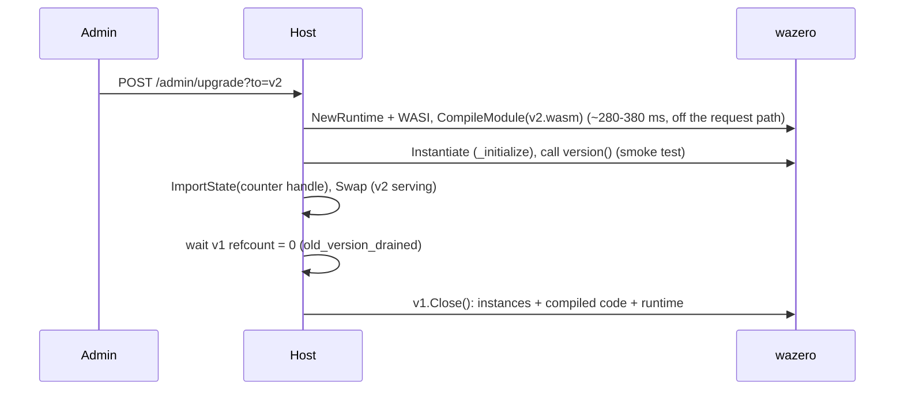

# S3 - Hot-Loading WebAssembly Modules with wazero (`cmd/s3-wasm`)

## 1. Problem addressed

S2 loads code dynamically but can never unload it, ties plugins to the host's
exact toolchain, and offers no isolation. S3 compiles the business logic to
WebAssembly (a WASI *reactor* module written in Go, built with
`GOOS=wasip1 GOARCH=wasm -buildmode=c-shared` and `//go:wasmexport`). It runs
the module in [wazero](https://github.com/tetratelabs/wazero) v1.11.0, a pure-Go
runtime with no cgo. Modules are loaded, swapped through `internal/hotswap`,
and **closed after the old version drains, which reclaims their memory**.

## 2. Design

```
                        host process (pure Go, CGO_ENABLED=0 possible)
 ┌───────────────────────────────────────────────────────────────────────────┐
 │ counter *atomic.Uint64  (service state, owned by host)                    │
 │                                                                           │
 │ hotswap.Registry ── cur ──► Module v2 ─ wazero.Runtime ─ CompiledModule   │
 │                              pool: [inst][inst][inst]..(≤ PoolSize, lazy) │
 │                     retired ► Module v1 ─ ... ──(refs→0)──► Close():      │
 │                                         instances, code, runtime freed    │
 └───────────────────────────────────────────────────────────────────────────┘
 /api: Acquire version ─► sleep work_ms ─► n := counter.Add(1)
       ─► take instance from pool ─► guest.handle(n, pid, ts) -> (ptr,len)
       ─► copy JSON out of linear memory ─► return instance ─► Release
```



**Guest ABI** (`cmd/s3-wasm/guest/{v1,v2}`):
`handle(count u64, pid u32, ts_ns i64) -> u64` returns a packed
`ptr<<32 | len` of the JSON body in the guest's linear memory.
`version() -> u64` returns the version string the same way. The host builds
the response headers itself (`X-Version` comes from the guest's `version()`).

**Where state lives.** The guest is deliberately **stateless**. The counter
is owned by the host and passed in as an argument. Consequences:
(1) any number of instances can serve concurrently without consistency
problems; (2) the module can be replaced without copying linear memory;
(3) the hot-swap `ExportState/ImportState` hand-over is a handle transfer, as
in S1 and S2. Persisting guest-internal state would require an explicit
export (serialize to bytes in the guest, copy through host memory, import in
the new guest). That export must happen during a quiescent phase, because
every instance holds its own copy.

**Concurrency.** A WASM instance is single-threaded. Each `Module` keeps a
bounded pool (`-pool`, default 8) of lazily created instances, guarded by a
slot semaphore. A request borrows an instance only for the guest call
(about 1 us). The `work_ms` sleep happens while only the *version* is pinned,
not an instance, so a pool of 8 serves hundreds of concurrent slow requests.
An instance that traps is discarded, never reused. A request that reaches a
closed module (impossible when it goes through `hotswap.Acquire`) gets
`ErrClosed` instead of blocking.

Files: `internal/hotswap/wasmimpl` (host), `cmd/s3-wasm/main.go`,
`cmd/s3-wasm/guest/{v1,v2}`, `cmd/s3-wasm/build.sh`, and
`cmd/s3-wasm/memgrowth`.

## 3. Correctness argument

* Swap safety and draining are inherited from `internal/hotswap` (S1
  section 3).
* **Unload safety.** `Close()` is invoked only from the `Unload` hook, which
  `svc` calls after `old.Drained()` is closed, that is, once no request holds
  the old version. Every use of a module instance happens strictly inside an
  `Acquire ... Release` window (the instance is returned to the pool before
  `Release`). Therefore no instance is in use when `Close` runs. The
  end-to-end test checks this: after the upgrade, it calls the old module
  directly and expects a failure, and it counts **zero** non-200 responses
  under load. Any request served by v1 after unload would have failed.
* **Memory isolation.** The guest can only read and write its own linear
  memory. The host bounds-checks the returned `(ptr,len)` through
  `Memory().Read`, and the response bytes are copied out before the
  instance returns to the pool. Linear memory is capped by
  `WithMemoryLimitPages` (default 32 MiB per instance).

## 4. How to run

```bash
cmd/s3-wasm/build.sh                         # bin/s3-wasm, bin/memgrowth, bin/modules/{v1,v2}.wasm
cmd/s3-wasm/bin/s3-wasm -addr :8080 -pool 8  # -module-dir defaults to <exe dir>/modules; -interpreter optional
curl -XPOST 'localhost:8080/admin/upgrade?to=v2'   # or kill -HUP <pid>
cmd/s1-epoch-swap/smoke.sh cmd/s3-wasm/bin/s3-wasm 18083
cmd/s3-wasm/bin/memgrowth -n 20              # unload after drain (default)
cmd/s3-wasm/bin/memgrowth -n 10 -no-unload   # keep old modules (emulates plugins)
go test -race ./cmd/s3-wasm/ && go test -run '^$' -bench . ./cmd/s3-wasm/
```

## 5. Measurements (Apple M4 Pro; Linux = Docker `golang:1.25`, arm64)

**End-to-end smoke test** (Linux): 204/204 `work_ms=50` requests returned 200.
Versions seen: 84 v1, 120 v2. Count duplicates: 0. Highest v1 count 168, lowest
v2 count 173. Load (compile, instantiate, smoke call) took 282 ms, during
which v1 kept serving. `drain_ns` was 32.9 ms and `total_ns` 315 ms. A SIGHUP
back to v1 also worked.

**Per-request and per-load cost** (Linux, `go test -bench`, 12 goroutines,
pool 16):

| Benchmark | Result |
|---|---|
| Guest call via compiler (`BenchmarkWasmHandle`) | 846-923 ns/op, 2 allocs |
| Guest call via interpreter | 1.97-2.20 us/op, 18 allocs |
| Load one module (`BenchmarkWasmLoad`: runtime, compile, 1 instance, close) | 279-281 ms, 33.5 MB allocated |

**Memory over repeated upgrades** (`memgrowth`, pool of 4 prewarmed
instances, alternating v2/v1, under 4 concurrent request loops):

| Platform / mode | RSS over 20 upgrades | Linear fit |
|---|---|---:|
| Linux, **unload after drain** | fluctuates 138-193 MiB (gen 1: 163, gen 20: 166) | **-0.3 MiB / upgrade (flat)** |
| Linux, no unload (references kept) | 173 -> 929 MiB in 10 upgrades | **+84 MiB / upgrade** |
| macOS, unload after drain | 218 MiB at gen 3 -> 218 MiB at gen 20 (+0.3 MiB total) | about 0 |
| macOS, no unload | 191 -> 1,093 MiB in 12 upgrades | +82 MiB / upgrade |

This is the key contrast with S2 (about +5 MiB per upgrade, which cannot be
avoided). With unloading, steady-state memory is bounded by *two* resident
versions (old and new overlap during draining). Without unloading, every
generation costs about 85 MiB: four Go-runtime guest instances (heap and
linear memory) plus compiled code, about 21 MiB per instance if attributed
evenly. That breakdown was not measured separately.

## 6. Limitations

* **Go guests are heavy.** The Go `wasip1` module is 1.6 MB, takes about
  280-380 ms to compile with wazero's optimizing compiler, and each instance
  carries a Go runtime and heap (about 20 MiB RSS). TinyGo or Rust guests
  would be one to two orders of magnitude smaller. Compile caching
  (`wazero.NewCompilationCacheWithDir`) can amortise repeated loads of the
  same binary.
* **Per-call overhead** is about 0.85 us (compiler) to about 2 us
  (interpreter), versus about 4 ns for an S1 dispatch. That is negligible for
  I/O-bound services but significant for compute-heavy, chatty interfaces.
  Strings and bytes cross the boundary by copying.
* **Restricted guest capabilities.** There are no goroutine-level threads
  inside the guest, and sockets and files are available only through WASI
  as granted by the host. Business logic that needs databases or HTTP clients
  needs host functions, which widens the ABI that must stay stable across
  versions.
* Guest-internal state is not migrated automatically (see section 2). Our
  workload keeps its state on the host.
* wazero's compiler supports amd64 and arm64. Other architectures fall back to
  the interpreter.

## 7. Threats to validity

* RSS on Linux fluctuates by about 50 MiB because the Go heap of the host and
  the guest instances' memory are returned to the OS lazily. Conclusions rest
  on the trend (linear fit) and on the explicit no-unload control, not on
  single samples.
* The `-no-unload` control keeps references alive. If old modules merely
  become unreachable without `Close`, wazero's finalizers eventually free
  them as well (observed in a preliminary run where RSS also plateaued).
  The control therefore models "cannot unload" (as with plugins), not
  "forgot to call Close".
* All measurements ran on one Apple M4 Pro host (Linux results inside a
  Docker VM). Absolute compile times will differ on x86 servers.
