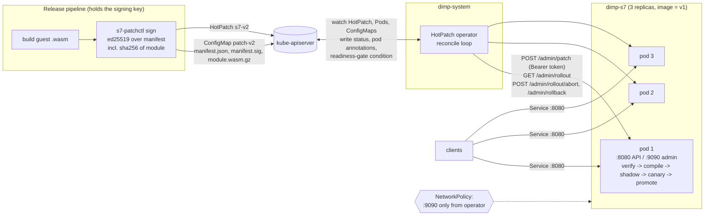
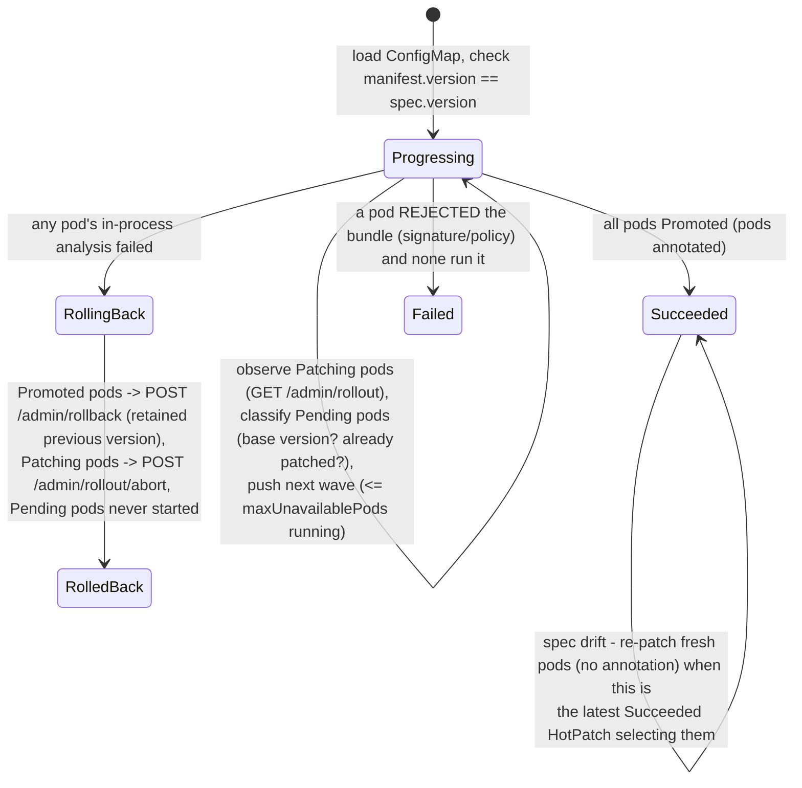

# S7 - Kubernetes-Aware In-Place Code Upgrades: Signed Hot Patches, In-Process Shadow/Canary, and a `HotPatch` Operator

*Gaps addressed: G5 (Kubernetes has no notion of an in-process upgrade), G6 (no
security model for runtime patches), G7 (no lightweight multi-version
validation). Paper ideas 4 and 6 in [`docs/paper-ideas.md`](../paper-ideas.md).*

| Component | Path |
|---|---|
| Patch signing / verification / admission policy | `internal/signing/` |
| In-process progressive delivery engine (shadow, canary, analysis, rollback) | `internal/canary/` |
| WASM guest host for the S7 ABI (separate shadow pool) | `internal/canary/wasmguest/` |
| Contract service with admin API | `cmd/s7-inplace/` (+ guests `guest/v1`, `v2` good, `v3` buggy) |
| CLI: keygen, sign, verify, push, status, abort, tamper | `cmd/s7-patchctl/` |
| In-cluster load generator (checks results and counter continuity) | `cmd/s7-load/` |
| Kubernetes operator (separate Go module) | `operator/` |
| Manifests, Dockerfiles | `deploy/s7/` |
| Demo on kind cluster `dimp-s7` | `scripts/s7_kind_demo.sh` -> `results/s7-demo/` |

S7 reuses `internal/hotswap` without modification. The unit that `hotswap.Registry`
publishes is a *routing plan*, not an implementation (section 4). It also reuses
`internal/hotswap/svc.EventLog`. `internal/canary/wasmguest` is a fork of
`internal/hotswap/wasmimpl` with a 4-argument ABI (`handle(count,pid,ts,x)`),
eager instance pre-warming, a separate shadow instance pool and
`WithCloseOnContextDone(true)`, so a looping guest can be cut off. The fork exists
because changing `wasmimpl` would have meant changing S3.

---

## 1. Problem

The Kubernetes model of a code change is **pod replacement**: Deployment
rolling update, blue/green, and canaries through Argo Rollouts or Flagger.
S1-S3 showed that a Go process can replace its business logic in-process with
zero failed requests and with its state intact. The orchestrator, however, cannot
see such an upgrade:

* it cannot trigger an in-process upgrade, order it across replicas, or roll it back;
* it cannot validate the new code progressively; every progressive-delivery
  tool shifts traffic **between pods running different images**;
* nothing establishes that the code loaded at runtime is authorised. An
  `/admin/upgrade` endpoint is an arbitrary-code-execution endpoint;
* after a pod restart, the image (v1) and the running code (v2) disagree
  (**spec drift**).

S7 makes in-place upgrades a first-class, declarative, verifiable Kubernetes
operation. A `HotPatch` object declares *which pods*, *which signed artifact*
and *which validation strategy*. The operator drives each pod through an
**in-process** shadow -> canary -> promote rollout. Every pod verifies the
signature itself, and one failing pod rolls the whole fleet back.

## 2. Architecture



Inside one pod (`cmd/s7-inplace`):

```
 POST /admin/patch ─► token ─► decode envelope (gzip, size cap) ─► ed25519 verify ─► sha256(module)==manifest
     ─► policy (target, schema, version > running | explicit rollback, base == running | reconcile)
     ─► wazero compile + instantiate + version() smoke test + pre-warm pools ─► canary.Engine.Start(strategy)

 /api ─► Engine.Serve:  pin plan (hotswap.Acquire)
                        Admit: count := counter.Add(1)   (host-owned state, once per client request)
                        pick ONE version from the plan (sticky hash of X-Canary-Key, or random)
                        call it; record per-version / per-stage metrics
                        shadow stage: mirror (same input, same state view) to the candidate
                                      asynchronously, holding the plan pin; diff ignoring "version"
                        release pin (or hand it to the mirror goroutine)
 analysis loop (every 100 ms): Analyze(stage window) ─► continue | next stage (Swap plan) | rollback (Swap plan)
 after promote/rollback: wait until every plan that referenced the dropped version drained ─► Close() (module unloaded)
```

## 3. The `HotPatch` CRD (`dimp.research.io/v1alpha1`)

```yaml
apiVersion: dimp.research.io/v1alpha1
kind: HotPatch
metadata: {name: s7-v2, namespace: dimp-s7}
spec:
  selector: {matchLabels: {app: s7-inplace}}   # target pods
  version: v2                                  # must equal the signed manifest's version
  artifact: {configMapRef: {name: patch-v2}}   # binaryData: manifest.json, module.wasm.gz
  signatureRef: {name: patch-v2, key: manifest.sig}   # detached signature + key id
  maxUnavailablePods: 1                        # pods running a rollout concurrently (fleet waves)
  adminPort: 9090
  repatchPolicy: Immediate                     # spec drift: Immediate | Full | Never
  strategy:
    shadowDuration: 5s                         # shadow stage (0s skips it)
    shadowSamples: 100
    steps: [{weight: 10, pause: 3s, minSamples: 10}, {weight: 50, pause: 3s, minSamples: 30}]
    slo: {maxErrorRateDelta: "0.01", maxP99Factor: "2", p99SlackMs: 2, maxMismatchRate: "0",
          failFastSamples: 20, warmupSamples: 20}
status:
  phase: Succeeded            # Pending | Progressing | Succeeded | RollingBack | RolledBack | Failed
  digest: 55eb97...           # sha256 of the module (what actually runs)
  baseVersion: v1
  promoted: 3
  total: 3
  startedAt / completedAt
  pods:                       # per-pod state and analysis evidence
  - {name: ..., uid: ..., phase: Promoted, fromVersion: v1, version: v2,
     metrics: {stage: canary-50, candidateSamples: 80, candidateP99Ms: "0.096", stableP99Ms: "0.117",
               mismatches: 0, decisionMs: "11001.311", verifyMs: "0.814", compileMs: "279.704"}}
  conditions: [Ready, Progressing]
```

Pod-side bookkeeping. The annotations `dimp.research.io/patch-version`,
`dimp.research.io/patch-digest` and `dimp.research.io/hotpatch` record the code
a pod is running, so `kubectl get pods -o yaml` shows the version even though the
image never changed. A pod condition, `dimp.research.io/patched`, is used as a
**readiness gate** (section 7).

Artifacts are stored in a ConfigMap. A Go `wasip1` module is about 1.6 MB, and
gzip brings it to about 470 KB, under the 1 MiB object limit. The signature
binds the digest of the **uncompressed** module. An OCI artifact reference would
be the production choice; `spec.artifact.url` is reserved for it and not
implemented.

## 4. In-process progressive delivery (`internal/canary`)

**Routing plans on top of `hotswap`.** `hotswap.Registry[*plan]` publishes a
plan of the form `{stable, candidate, mode, weight, metrics window}`. Every stage
transition, promotion and rollback is a `Registry.Swap` of a new plan. A request
pins one plan for its whole life, including any shadow mirror it spawns, and
selects **one** version from that plan. This gives **per-request version
pinning**: no request ever runs on two versions.

A version is unloaded only after *every* plan that referenced it has drained:
the pre-rollout plan plus each stage plan, which are the `Old` sides of all the
rollout's `Upgrade`s. This reuses S1's per-version epoch draining unchanged.
The S1 argument therefore carries over directly: drain time is bounded by the
longest request (or mirror) that was admitted under an old plan.

**Stages.** The default sequence is `shadow -> canary 1% -> 10% -> 50% -> promote`.
The stages are configurable, and a stage with `weight >= 1` is the promotion step.
Each stage needs `MinDuration` **and** `MinSamples`. A stage that reaches
`MaxDuration` without enough samples **fails closed** (rolls back). Section 9.1
shows why this matters.

**Analysis** (`Analyze`, a pure function evaluated on each stage's own window):

```
errRate(cand) <= errRate(stable) + maxErrorRateDelta
p99(cand)     <= max(p99(stable) * maxP99Factor, p99(stable) + p99Slack)
mismatchRate  <= maxMismatchRate                    (shadow stages)
```

Error-rate and mismatch violations **fail fast** once `failFastSamples` (20)
have been seen. Latency is judged only at full evaluation, because the p99 of a
handful of samples is noise. The first `warmupSamples` calls a candidate receives
are excluded from its latency histogram (finding 9.2). Histograms use
log-spaced buckets (ratio 1.08, so at most 8% quantile error) of atomic counters,
which keeps the hot path lock-free.

**Shadow mode and side-effect isolation.** S7 uses the S3 state model: service
state (the counter) belongs to the **host**, and a guest is a function of
`(input, state view)`.

1. `Config.Admit` applies the state transition (`count = counter.Add(1)`)
   **exactly once per client request**, before dispatch.
2. The resulting view (`count`, `ts`) travels inside the request input. The
   mirror passes the **same input value** to the candidate. The candidate
   receives a copy of the state view the stable version saw and has **no
   handle** to host state.
3. The candidate's shadow calls run on a **separate wazero instance pool**. A
   guest that kept memory between calls therefore could not leak mirrored
   traffic into the instances that serve clients. A WASI guest has no
   filesystem, network, environment or stdout, so in this design it has no
   other side-effect channel.
4. Because the inputs are identical, stable and candidate bodies must be
   identical apart from the declared divergence (`"version"`). The comparator
   is exact, not heuristic, and a single mismatch is real behavioural divergence.
   That is why the demo uses `maxMismatchRate: "0"`.
5. Mirrors are bounded (`ShadowConcurrency`, default 64). Excess mirrors are
   **dropped and counted**, never queued, so shadowing cannot apply backpressure
   to clients. The mirror runs after the stable response is ready, and its
   latency is never on the client path.

The test `TestGoodCandidatePromotedUnderLoad` asserts that after a full
rollout, `counter == client requests`, meaning the mirrors performed no state
transitions. For services whose versions write to external systems (databases,
queues), shadowing needs a read-only or recording facade passed to
`Version.Shadow`. The engine supports a separate `Shadow` function for exactly
that purpose, but S7 does not implement such facades.

**Rollout state machine (one pod):**

```mermaid
stateDiagram-v2
  [*] --> Idle
  Idle --> Shadow: POST /admin/patch accepted<br/>(verified, compiled, pre-warmed)
  Shadow --> Canary1: SLO met (min duration and samples)
  Canary1 --> Canary10: SLO met
  Canary10 --> Canary50: SLO met
  Canary50 --> Promoted: SLO met (plan {stable=cand}); old version drained then unloaded
  Shadow --> RolledBack: mismatch / errors (fail-fast), p99, or insufficient data at MaxDuration
  Canary1 --> RolledBack
  Canary10 --> RolledBack
  Canary50 --> RolledBack
  Shadow --> Aborted: POST /admin/rollout/abort (operator fleet halt)
  Canary10 --> Aborted
  RolledBack --> Idle: candidate drained then unloaded
  Aborted --> Idle
  Promoted --> Idle: previous artifact retained for POST /admin/rollback
```



## 5. Operator control loop (`operator/`)

`HotPatchReconciler` (controller-runtime v0.21) is requeued every second while
a patch is progressing and is also triggered by Pod events:



* **Fleet decision** (`controller.Decide`, unit-tested). A failure in one pod's
  analysis is treated as evidence against the patch everywhere: halt and revert.
  A rejection before execution (bad signature) fails the HotPatch without any
  rollback, because nothing ran.
* **Waves** (`controller.NextWave`). At most `maxUnavailablePods` pods are in a
  rollout at once. No pod ever becomes unavailable; the field name mirrors
  Deployment semantics.
* **Idempotency.** A pod that already runs the target version is marked
  Promoted (operator restart). A duplicate push answered with `409
  RolloutInProgress` or `VersionPolicy` is resolved by asking the pod what it
  runs (section 9.4).
* **Pods on another version** (for example a fresh pod still being re-patched by
  an earlier HotPatch) are `Waiting`, not failed.
* **Trust split.** The operator never needs to be trusted for code integrity. It
  forwards bytes and the pod verifies them. A compromised operator can at most
  push *validly signed* older or newer patches, and replays and downgrades are
  refused by the pod (section 6).

## 6. Security model

**Assets:** the code executing inside production pods, and the pods' in-memory
state. **Threat:** the upgrade endpoint is a remote-code-loading API. Without
controls, anyone who can reach it runs arbitrary code with the pod's identity
and secrets (H3 of paper idea 4).

| Threat (STRIDE) | Attacker | Control in S7 | Tested by |
|---|---|---|---|
| Tampering: substitute module | registry, ConfigMap or network attacker | ed25519 signature over manifest; manifest binds `sha256` and `size` of uncompressed module; domain-separated message `dimp-patch-v1\0` | `TestTamperedModule`, demo step 3 (HTTP 403) |
| Tampering: edit manifest (bump version) | same | signature covers manifest bytes; `DisallowUnknownFields` | `TestTamperedManifest` |
| Spoofing: rogue signer | anyone with a key | only keys in `-trusted-keys` (ConfigMap mounted read-only); key id = `sha256(pub)[:8]` | `TestWrongKey`, `TestPatchAdmissionSecurity` |
| Replay / downgrade (rollback attack) | holder of old *validly signed* bundles | `version` must be greater than running (semantic compare, `v10 > v9`), unless an explicit, authenticated rollback names a *retained* version; `base_version` must equal running unless the operator's `reconcile` flag is set | `TestReplayAndDowngrade`, `TestPatchAdmissionSecurity` |
| Wrong target / incompatible state | misconfiguration, confused deputy | `name` must equal service; `compatible_state_schema` must equal host schema; module's own `version()` must equal manifest version | `TestPolicyTargetSchemaBaseAge`, version-lie test |
| Elevation via endpoint access | any pod in the cluster | admin API on a separate port (`:9090`); constant-time bearer token from a Secret; NetworkPolicy allows `:9090` only from the operator pod | `TestPatchAdmissionSecurity` (401), demo: "admin port BLOCKED" |
| DoS: zip bomb / huge bundle | endpoint caller | gzip decompression capped (`MaxBundleBytes` 8 MiB, verifier cap 64 MiB); request size capped | `TestZipBombAndSizeLimits` |
| DoS: patch that hangs or traps | malicious or buggy signed code | wazero sandbox; memory cap (32 MiB per instance); trapped instance discarded; shadow calls time out and `CloseOnContextDone` interrupts loops; panics recovered as errors | `TestAbortAndPanicIsolation` |
| Repudiation | insider | signed manifest (who signed, by key id); `/admin/rollout` keeps the last 20 admission decisions with reason; HotPatch status and Kubernetes events; pod annotations record the running digest | demo `k8s-events.txt` |

Who can push patches: (1) whoever can create `HotPatch` and ConfigMaps (RBAC
role `hotpatch-publisher`, intended for the release pipeline); (2) whoever holds
the admin token and can reach `:9090` (the operator). **Neither can run
unsigned code.** Only the holder of the release private key can create new
executable content, so the root of trust is the signing key plus the image. The
built-in v1 module is trusted because it is in the image, which is covered by
image signing or admission policy.

Signature checks are cheap. Verifying a 1.6 MB module takes **0.72 ms** on an
M4 Pro (`BenchmarkVerify`) and **0.52-0.83 ms** in the kind pods (`verifyMs` in
the HotPatch status). That is about 1/400 of the wazero compile time (275-358
ms), which supports H2 of idea 4 by a wide margin.

*Not implemented, and discussed as future work:* mTLS between operator and pods
(SPIFFE identities instead of a shared token, which every pod also holds);
Sigstore/cosign keyless signing with transparency-log inclusion (a stolen key is
currently undetectable); TUF-style key rotation and expiry (`Policy.MaxAge`
exists but is unused in the demo); in-toto attestations of the guest build.

## 7. Consistency model and spec drift

* **Per request:** exactly one version (plan pinning). **Per key:** with
  `X-Canary-Key` set, assignment within a stage is a deterministic FNV hash,
  so a user sticks to one version for the duration of that stage
  (`TestStickyKeyRouting`). The assignment is re-drawn at each stage change.
* **Per pod, during a rollout:** two versions are live and both write the *same*
  host state (the counter is shared, never copied). The demo checks that no
  per-pod count is duplicated or reset (`counter_resets: 0`).
* **Across the fleet:** mixed versions are expected during waves. In the demo,
  v1 and v2 were both served for about 35 s. This is the same as a rolling update
  and needs backward-compatible APIs. S7 does not address cross-replica version
  consistency (see Chait-Roth et al. in the survey).
* **Spec drift.** A pod's image still says v1 after the patch. When a pod is
  recreated (eviction, node failure, scale-up), it starts with the image code.
  S7 handles this in three ways. (a) The newest Succeeded HotPatch re-patches
  fresh pods: those without a `patch-version` annotation, with `repatchPolicy:
  Immediate`, since the fleet has already validated the patch. (b) The
  Deployment declares a **readiness gate** `dimp.research.io/patched`, which the
  operator sets to False ("SpecDrift") until the pod runs the fleet version, so
  the pod never receives traffic with stale code. (c) Pod annotations and the
  status `digest` expose the code that is actually running. The trade-off is
  that the **operator becomes part of the availability path for new pods**: if it
  is down, recreated pods stay NotReady. The durable fix is to "bake" a
  succeeded patch into the next image. A HotPatch is a fast, reversible bridge,
  and the image should then catch up.

## 8. Comparison

| | Deployment rolling update | Argo Rollouts / Flagger | OpenKruise in-place update | K8s in-place pod resize (KEP-1287) | **S7 HotPatch** |
|---|---|---|---|---|---|
| Unit of change | pod (new image) | pod / ReplicaSet (new image), traffic shifted via mesh or ingress | container image swapped in the **same pod** (container restart) | CPU and memory of a running container | **business logic inside the running process** |
| Process restart | yes | yes | yes (container restarts) | no | **no** |
| In-memory state | lost | lost | lost (container restart) | kept | **kept** (counter continued; 0 resets) |
| Connections | dropped / drained | dropped / drained | dropped | kept | **kept** |
| Surge capacity | `maxSurge` pods | a full canary or preview ReplicaSet | none | none | **none** (two module versions in one pod: about 2x module memory during rollout) |
| Time per pod | schedule + pull + start + readiness (s to min) | same, plus analysis | pull + container restart | seconds | verify ~0.8 ms + compile ~0.3 s + analysis (configurable) |
| Progressive validation | none (readiness only) | yes, **between pods**, by traffic weight | partition-based batches | n/a | yes, **within each pod**: shadow (zero client exposure) then weighted canary |
| Shadow / mirroring | no | via mesh mirroring (Istio), new pods needed | no | n/a | built in, request-level diff with exact state view |
| Rollback | new rollout (pods replaced again) | traffic shift back (fast) | image swap back (restart) | resize back | plan swap back (**ms**); fleet: re-install retained version in place |
| Code provenance enforced at load | image policy (admission) | image policy | image policy | n/a | **per-pod signature check of every patch** + image policy for base |
| Applicability | any container | any container | any container | resources only | services whose logic is a sandboxed module (WASM) with host-owned state |

Argo Rollouts and Flagger answer the question "which **pods** get traffic?". S7
answers "which **code version inside each pod** handles this request?". The two
compose: a mesh could still split traffic between pods, and S7 makes each pod's
own upgrade safe.

## 9. Measured demo results (`results/s7-demo/`, kind v0.29, 1 node, Docker Desktop on M4 Pro)

Setup: 3 replicas of `s7-inplace` (image code v1), in-cluster load at 150 rps
(`s7-load`, open loop, one TCP connection per request). The load generator
checks every status code, every `result` against the v1 reference semantics,
and per-pod counter continuity.

| Step | Outcome | Time | Client impact (load covering steps 1-3: 7,618 requests) |
|---|---|---|---|
| 1. HotPatch v2 (good), `maxUnavailablePods: 1` | **Succeeded**, 3/3 pods promoted in place, waves of 1 pod; per pod: shadow 5 s -> 10% -> 50% -> promote (in-pod decision 11.0 s) | 34.9 s apply -> Succeeded | **0 failed, 0 wrong results** |
| Pods after v2 | **same 3 UIDs, restartCount 0**, annotation `patch-version=v2`; per-pod counters continued v1 -> v2 (max count matches requests served: 2471 / 2508 / 2644) | | **0 counter resets** |
| 2. HotPatch v3 (buggy: wrong for `x%10==3`, +4 ms), `maxUnavailablePods: 3` | **RolledBack**. Pod `5rhjn` caught it **in shadow**: 3 mismatches in 23 mirrors (cand p99 4.02 ms vs stable 0.023 ms), fail-fast **602 ms** after the pod accepted the patch; operator aborted the other two pods (in-pod abort 5 ms and 351 ms after their own start) | **1.15 s** apply -> fleet RolledBack | **0 failed, 0 wrong**, 0 requests served by v3 |
| 3. HotPatch v4 (tampered: signed v4 manifest, module swapped for v3) | **Failed**: pod answered `403 SignatureInvalid: module digest does not match signed manifest` (verify 0.055 ms, compile not attempted); fleet halted, other pods never contacted | 49 ms | none |
| NetworkPolicy | load pod -> pod `:9090`: **blocked** (kindnet enforces policies) | | |
| 4. Spec drift: delete one pod | replacement starts with image code v1: gate `patched=False (SpecDrift)` -> operator re-patched it to v2 (Immediate) -> gate True -> **Ready after 4.0 s**; never Ready while running v1 | 4.0 s | not measured (no load in step 4) |

Client latency over the whole run: p50 1.29 ms, p99 4.46 ms, p99.9 48.9 ms,
max 1009 ms. These are end-to-end numbers through kube-proxy with a new TCP
connection per request. The single request of about 1 s matches a TCP SYN
retransmission timeout, but this is **unverified**: the request did not fail,
and it would need a packet capture to confirm. The per-pod in-process latency
of the stable version was 0.02-0.2 ms (HotPatch status `stableP99Ms`).

### Research-relevant findings

1. **In-pod analysis needs per-pod traffic; persistent connections break that
   assumption** (`results/s7-demo/run1-keepalive-imbalance/`). In the first
   run, the load generator kept 32 HTTP keep-alive connections. kube-proxy
   balances *connections*, and one of the three pods received **0 of 18,872
   requests**. Its shadow stage could not collect samples and **failed closed**
   after `MaxDuration` (80 s). The fleet rule then **reverted the pod that had
   already been promoted** (v2 -> v1 in place). Clients saw 0 failures and 0
   wrong answers throughout, so the safety logic behaved correctly. However, a
   correct patch was rejected because of the traffic distribution. Consequences:
   (a) fail-closed on insufficient data is necessary, because otherwise an idle
   pod would "pass" with zero evidence; (b) a fleet-level operator should pool
   evidence across pods or pre-check per-pod traffic; (c) pod-to-pod canaries
   (Argo Rollouts) share this weakness under connection-level balancing.
2. **Cold candidates look slow.** In a local smoke test, a *correct* v2 was
   rolled back on p99 (3.2 ms vs 0.03 ms) because its first shadow calls paid
   for lazy creation of WASM instances (Go runtime `_initialize`, milliseconds).
   The fix has two parts: pre-warm the instance pools at load time (off the
   request path) and exclude the first `warmupSamples` calls from the
   candidate's latency histogram. An in-process comparison is so precise
   (stable p99 about 20 us) that one-off initialisation dominates. Any
   latency-based in-process canary must model warm-up explicitly.
3. **Exact diffing is possible in-process.** Because the host passes the
   *same* state view to both versions, outputs are deterministic and the
   comparator needs only the declared divergence (`version`). One mismatch is
   conclusive, so detection took 23 mirrors (0.6 s at about 50 rps per pod)
   instead of the hundreds of samples a statistical canary needs.
4. **Controller idempotency.** In an earlier full run, a status-update conflict
   made the operator push v2 twice to one pod. The pod's single-rollout guard
   returned `409 RolloutInProgress`, so nothing unsafe happened. The controller
   now resolves 409s by querying the pod. In-process patching needs the same
   at-most-once care that Kubernetes gives pod creation.
5. **Verification is negligible** (about 0.8 ms per 1.6 MB module) compared with
   compiling (about 300 ms) and with pod replacement (seconds). Security does
   not compete with speed here.

Unit-level results (`go test -race`, macOS and `golang:1.25` Linux/arm64):
`internal/signing` 9 tests (tamper, wrong key, replay, downgrade, base, schema,
age, zip bomb, key files); `internal/canary` 10 tests, including a buggy
candidate caught in shadow with **0 client errors and 0 wrong answers** (decision
about 10 ms), the same bug without a shadow stage limited (in one run) to **9 errors in 4,736
requests (0.19%)**, none after the decision, a latency regression rolled back on
p99, and panic isolation; `cmd/s7-inplace` 3 integration tests with real WASM
modules (contract harness upgrade under load, v3 caught in shadow, admission
security matrix). Engine overhead: `Serve` 238 ns/op stable-only and 252 ns/op
during shadow (parallel benchmark, M4 Pro; most mirrors are dropped at that
rate by design).

## 10. Limitations

* **Spec drift remains a real operational cost.** The image and the running code
  diverge until the image is rebuilt. The readiness gate puts the operator on the
  path to Ready for new pods. `kubectl describe deploy` still says v1, and only
  annotations, status and metrics show the truth.
* **Only module-shaped code can be patched.** The host (HTTP stack, runtime,
  WASM engine) cannot be patched in place; that still needs replacement or
  S4/S5-style handoff. The guest ABI is fixed per host version.
* **State schema changes are rejected, not migrated.** A patch must declare the
  host's `compatible_state_schema`. A migration hook (S1's
  `ExportState`/`ImportState`) would be needed, and shadowing a version with a
  different schema needs a transformed state view.
* **Shadowing side-effecting endpoints** needs a read-only or recording facade
  for external writes. It is not provided. The demo service's only state
  transition is host-owned.
* **Memory:** during a rollout a pod holds two compiled modules plus two
  instance pools (about 2x module memory). After promotion the old module is
  closed. The previous *artifact bytes* (about 1.6 MB) are retained for rollback.
* **Observability:** metrics live in the pod (`/admin/rollout`) and in
  HotPatch status. They are not exported to Prometheus.
* **Evidence is per pod.** Small pods or uneven balancing starve the analysis
  (finding 1). Fleet-level pooling is not implemented.
* **Demo scale:** 1 kind node, 3 replicas, a synthetic deterministic workload,
  and one run per scenario (plus the first run, kept as evidence). These are
  feasibility results, not a statistically powered comparison with rolling
  update or OpenKruise. Those comparisons belong to the benchmark harness.
* `HotPatch` deep copies use a JSON round trip instead of generated code.
  `spec.artifact.url` is not implemented. The admin token is shared by all pods.

## 11. Future work

1. Fleet-level evidence pooling: aggregate shadow and canary windows across pods
   in the operator, and judge with sequential tests (SPRT) instead of fixed
   minimum samples.
2. mTLS with SPIFFE workload identities between operator and pods; Sigstore
   keyless signing with Rekor inclusion proofs; TUF key rotation; admission
   webhook that validates HotPatch artifacts at creation time.
3. OCI artifacts (ORAS) instead of ConfigMaps; content-addressed caching per node.
4. Export Prometheus metrics (running digest, rollout stage, mismatch rate) and
   an `ImageDrift` condition; automate "bake into the next image".
5. Schema-migrating patches: shadow a v(n+1) whose state view is produced by a
   transformer, and validate the transformer itself (idea 7).
6. Mutation-testing study (idea 6): inject operators into v2 and measure the
   detection rate and time against shadow sampling rate and overhead.
7. Head-to-head kind experiments against rolling update and OpenKruise in-place
   update across 3-50 replicas, with state size and long-lived connections.

## 12. Reproduce

```bash
go test -race ./internal/signing/... ./internal/canary/... ./cmd/s7-inplace/...
(cd operator && go build ./... && go vet ./... && go test ./...)
cmd/s7-inplace/build.sh && cmd/s7-inplace/bin/s7-inplace &      # local
curl -XPOST 'localhost:8080/admin/upgrade?to=v2'                # contract harness (fast schedule)
cmd/s7-inplace/bin/s7-patchctl push -bundle cmd/s7-inplace/bin/bundles/v3 -url http://localhost:8080 -strategy fast
scripts/s7_kind_demo.sh                                          # kind cluster "dimp-s7" (kept; KEEP=0 deletes it if this run created it)
```
