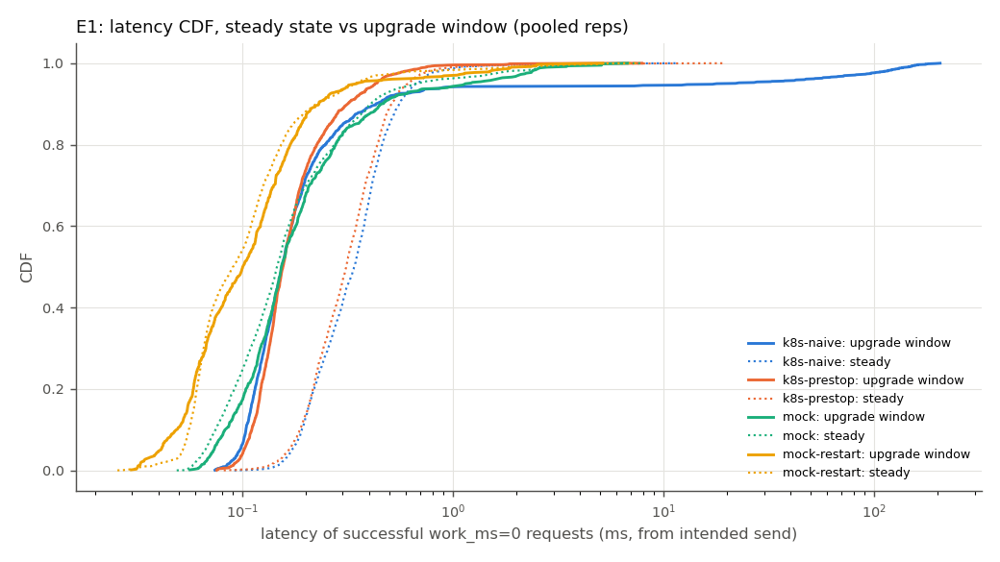
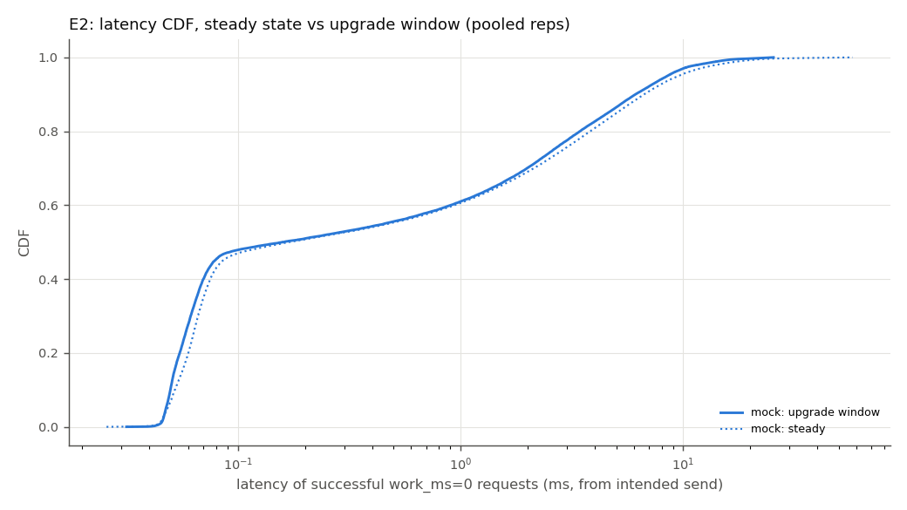
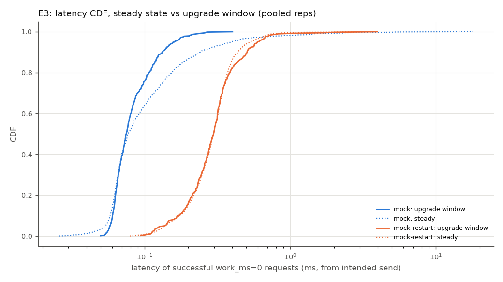
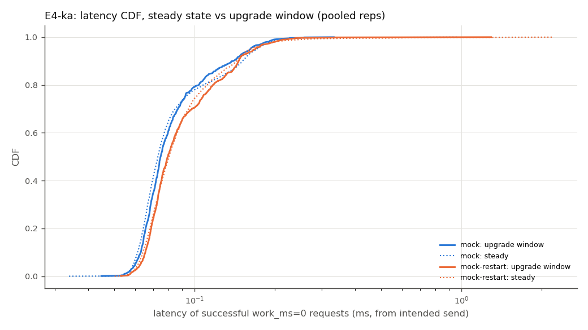
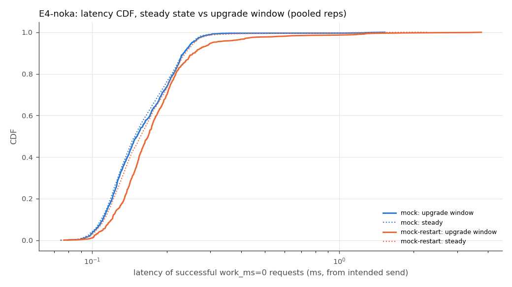
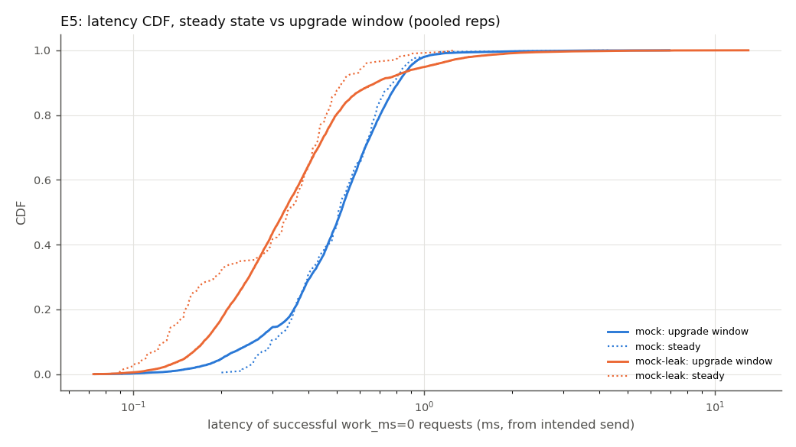
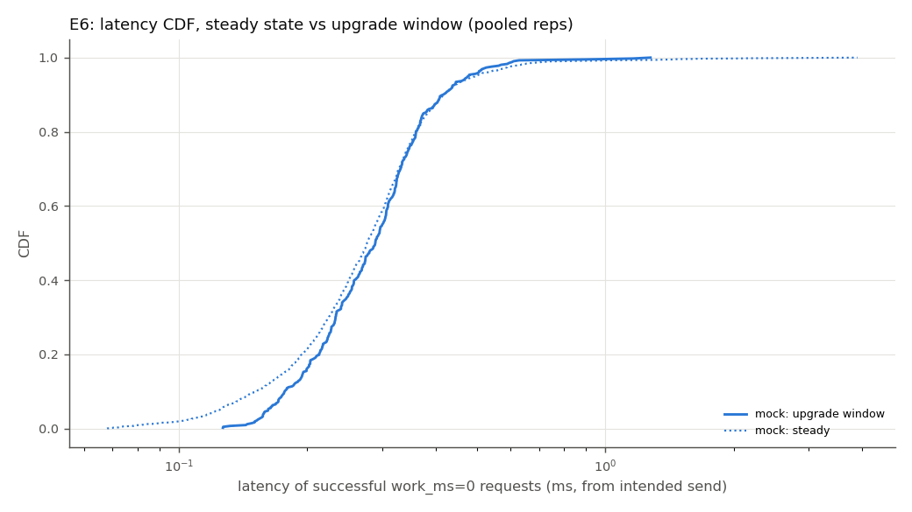

# DIMP benchmark summary

Generated by `bench/analysis/analyze.py`. Values: mean ± 95% CI half-width (Student t) over repetitions;
`n/a` = not applicable / not observable. Metric definitions: `docs/evaluation-methodology.md`.

## E1

Repetitions: k8s-naive: n=3, k8s-prestop: n=3, mock: n=3, mock-restart: n=3

| metric | k8s-naive | k8s-prestop | mock | mock-restart |
|---|---|---|---|---|
| error rate | 1.06e-03 ± 1.21e-03 | 3.55e-05 ± 1.53e-04 | 0.00e+00 ± 0.00e+00 | 1.77e-02 ± 4.22e-04 |
| errors | 10.0 ± 11.4 | 0.3 ± 1.4 | 0.0 ± 0.0 | 60.3 ± 1.4 |
| downtime ms | 185.3 ± 69.2 | 8.6 ± 8.8 | 9.0 ± 5.5 | 306.0 ± 3.7 |
| steady max gap ms | 12.4 ± 12.1 | 14.0 ± 22.4 | 11.5 ± 3.2 | 9.4 ± 6.6 |
| fail window ms | 15.0 ± 12.4 | 1.7 ± 7.2 | 0.0 ± 0.0 | 301.7 ± 7.2 |
| refused window ms | 231.7 ± 699.6 | 0.0 ± 0.0 | 0.0 ± 0.0 | 300.0 ± 0.0 |
| p99 steady ms | 1.03 ± 0.27 | 0.99 ± 0.21 | 2.26 ± 3.19 | 1.65 ± 4.19 |
| p99 upg ms | 134.38 ± 62.82 | 0.65 ± 0.31 | 2.58 ± 5.44 | 1.51 ± 3.00 |
| p99.9 upg ms | 170.46 ± 73.80 | 2.90 ± 5.53 | 3.60 ± 6.06 | 2.48 ± 5.37 |
| max upg ms | 177.5 ± 68.3 | 3.9 ± 8.7 | 3.8 ± 6.3 | 2.7 ± 5.8 |
| upgrade ms | 1409.7 ± 54.8 | 1440.5 ± 53.6 | 21.3 ± 1.6 | 322.7 ± 5.2 |
| mix ms | 0.0 ± 0.0 | 0.0 ± 0.0 | 0.0 ± 0.0 | 0.0 ± 0.0 |
| resets | 2.7 ± 1.4 | 2.7 ± 1.4 | 0.0 ± 0.0 | 1.0 ± 0.0 |
| dups | 5087.0 ± 142.0 | 5030.7 ± 1167.9 | 0.0 ± 0.0 | 1333.7 ± 1.4 |
| RSS growth MiB | n/a | n/a | 0.59 ± 0.39 | 0.33 ± 0.18 |
| client lag p99 ms | 0.30 ± 0.26 | 0.14 ± 0.02 | 0.59 ± 1.99 | 0.82 ± 2.19 |
| versions seen | v1 v2 | v1 v2 | v1 v2 | v1 v2 |

## E2

Repetitions: mock: n=2

| metric | mock |
|---|---|
| error rate | 0.00e+00 ± 0.00e+00 |
| errors | 0.0 ± 0.0 |
| downtime ms | 12.7 ± 38.6 |
| steady max gap ms | 15.7 ± 114.5 |
| fail window ms | 0.0 ± 0.0 |
| refused window ms | 0.0 ± 0.0 |
| p99 steady ms | 11.27 ± 136.21 |
| p99 upg ms | 9.98 ± 90.69 |
| p99.9 upg ms | 16.92 ± 97.26 |
| max upg ms | 18.3 ± 90.8 |
| upgrade ms | 25.9 ± 70.8 |
| mix ms | 0.0 ± 0.0 |
| resets | 0.0 ± 0.0 |
| dups | 0.0 ± 0.0 |
| RSS growth MiB | 3.05 ± 38.91 |
| client lag p99 ms | 2.86 ± 35.98 |
| versions seen | v1 v2 |

## E3

Repetitions: mock: n=2, mock-restart: n=2

| metric | mock | mock-restart |
|---|---|---|
| error rate | 0.00e+00 ± 0.00e+00 | 2.09e-02 ± 0.00e+00 |
| errors | 0.0 ± 0.0 | 71.0 ± 0.0 |
| downtime ms | 17.5 ± 31.8 | 104.0 ± 361.7 |
| steady max gap ms | 22.5 ± 31.9 | 22.8 ± 36.6 |
| fail window ms | 0.0 ± 0.0 | 355.0 ± 0.0 |
| refused window ms | 0.0 ± 0.0 | 352.5 ± 31.8 |
| p99 steady ms | 1.71 ± 7.47 | 0.75 ± 0.21 |
| p99 upg ms | 0.23 ± 0.21 | 0.84 ± 0.03 |
| p99.9 upg ms | 0.31 ± 0.58 | 2.69 ± 9.16 |
| max upg ms | 0.3 ± 0.8 | 3.0 ± 12.3 |
| upgrade ms | 474.1 ± 534.8 | 375.0 ± 0.1 |
| mix ms | 447.5 ± 539.9 | 88.3 ± 528.6 |
| resets | 0.0 ± 0.0 | 1.0 ± 0.0 |
| dups | 0.0 ± 0.0 | 1324.5 ± 6.4 |
| RSS growth MiB | 0.51 ± 1.71 | 0.38 ± 0.00 |
| client lag p99 ms | 0.09 ± 0.16 | 0.24 ± 1.55 |
| versions seen | v1 v2 | v1 v2 |

## E4-ka

Repetitions: mock: n=2, mock-restart: n=2

| metric | mock | mock-restart |
|---|---|---|
| error rate | 0.00e+00 ± 0.00e+00 | 2.07e-02 ± 0.00e+00 |
| errors | 0.0 ± 0.0 | 176.0 ± 0.0 |
| downtime ms | 6.0 ± 0.3 | 273.9 ± 1.8 |
| steady max gap ms | 6.1 ± 0.5 | 6.1 ± 0.9 |
| fail window ms | 0.0 ± 0.0 | 352.0 ± 0.0 |
| refused window ms | 0.0 ± 0.0 | 352.0 ± 0.0 |
| p99 steady ms | 0.21 ± 0.10 | 0.27 ± 0.88 |
| p99 upg ms | 0.20 ± 0.07 | 0.22 ± 0.17 |
| p99.9 upg ms | 0.26 ± 0.46 | 0.53 ± 3.85 |
| max upg ms | 0.3 ± 0.7 | 0.8 ± 6.7 |
| upgrade ms | 103.0 ± 11.6 | 373.2 ± 4.1 |
| mix ms | 79.9 ± 1.5 | 0.0 ± 0.0 |
| resets | 0.0 ± 0.0 | 1.0 ± 0.0 |
| dups | 0.0 ± 0.0 | 3310.0 ± 0.0 |
| RSS growth MiB | -0.01 ± 1.04 | -0.04 ± 1.51 |
| client lag p99 ms | 0.02 ± 0.02 | 0.02 ± 0.04 |
| versions seen | v1 v2 | v1 v2 |

## E4-noka

Repetitions: mock: n=2, mock-restart: n=2

| metric | mock | mock-restart |
|---|---|---|
| error rate | 0.00e+00 ± 0.00e+00 | 2.08e-02 ± 7.47e-04 |
| errors | 0.0 ± 0.0 | 176.5 ± 6.4 |
| downtime ms | 7.0 ± 11.8 | 274.2 ± 13.1 |
| steady max gap ms | 6.1 ± 0.7 | 6.1 ± 0.0 |
| fail window ms | 0.0 ± 0.0 | 353.0 ± 12.7 |
| refused window ms | 0.0 ± 0.0 | 352.0 ± 25.4 |
| p99 steady ms | 0.30 ± 0.07 | 0.34 ± 0.38 |
| p99 upg ms | 0.31 ± 0.24 | 0.81 ± 5.02 |
| p99.9 upg ms | 1.05 ± 4.87 | 2.78 ± 3.77 |
| max upg ms | 1.3 ± 3.0 | 3.6 ± 2.4 |
| upgrade ms | 103.2 ± 24.2 | 374.9 ± 15.9 |
| mix ms | 80.0 ± 24.5 | 0.0 ± 0.0 |
| resets | 0.0 ± 0.0 | 1.0 ± 0.0 |
| dups | 0.0 ± 0.0 | 3310.0 ± 12.7 |
| RSS growth MiB | -0.06 ± 0.69 | 0.12 ± 0.00 |
| client lag p99 ms | 0.02 ± 0.06 | 0.02 ± 0.02 |
| versions seen | v1 v2 | v1 v2 |

## E5

Repetitions: mock: n=1, mock-leak: n=1

| metric | mock | mock-leak |
|---|---|---|
| error rate | 0.00e+00 | 0.00e+00 |
| errors | 0.0 | 0.0 |
| downtime ms | 16.4 | 22.6 |
| steady max gap ms | 13.5 | 10.8 |
| fail window ms | 0.0 | 0.0 |
| refused window ms | 0.0 | 0.0 |
| p99 steady ms | 1.12 | 0.91 |
| p99 upg ms | 1.15 | 1.93 |
| p99.9 upg ms | 3.31 | 5.32 |
| max upg ms | 7.0 | 13.0 |
| upgrade ms | 21.3 | 21.8 |
| mix ms | 0.0 | 0.0 |
| resets | 0.0 | 0.0 |
| dups | 0.0 | 0.0 |
| RSS growth MiB | 2.99 | 59.27 |
| RSS KiB/upgrade | 30.5 | 1164.4 |
| client lag p99 ms | 0.48 | 0.88 |
| versions seen | v1 v2 | v1 v2 |

## E6

Repetitions: mock: n=2

| metric | mock |
|---|---|
| error rate | 0.00e+00 ± 0.00e+00 |
| errors | 0.0 ± 0.0 |
| downtime ms | 6.7 ± 1.2 |
| steady max gap ms | 8.4 ± 2.9 |
| fail window ms | 0.0 ± 0.0 |
| refused window ms | 0.0 ± 0.0 |
| p99 steady ms | 0.73 ± 0.65 |
| p99 upg ms | 0.56 ± 0.58 |
| p99.9 upg ms | 1.12 ± 0.94 |
| max upg ms | 1.2 ± 0.7 |
| resets | 0.0 ± 0.0 |
| dups | 0.0 ± 0.0 |
| RSS growth MiB | 0.53 ± 0.40 |
| client lag p99 ms | 0.20 ± 0.66 |
| rollback ok (runs) | 2/2 |
| versions seen | v1 |

