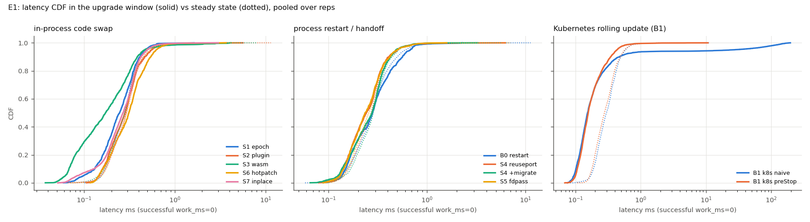
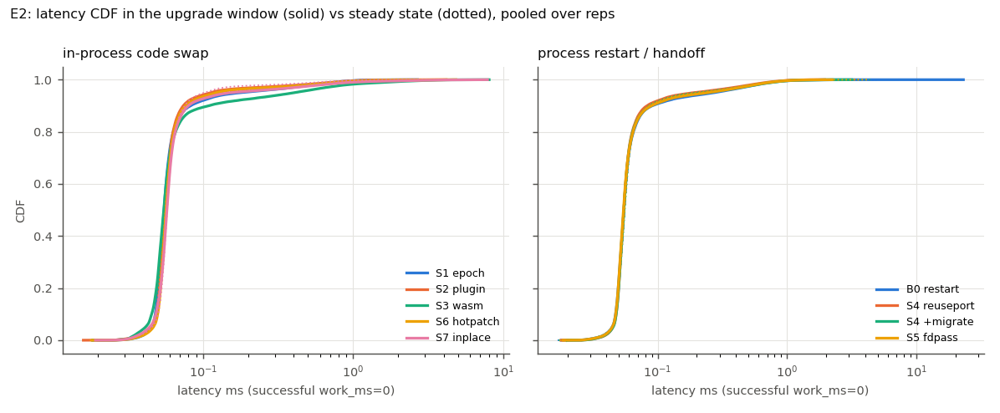
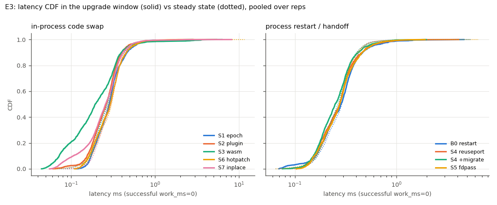
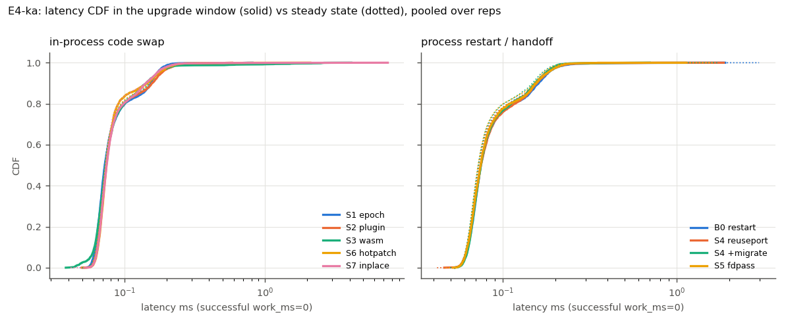
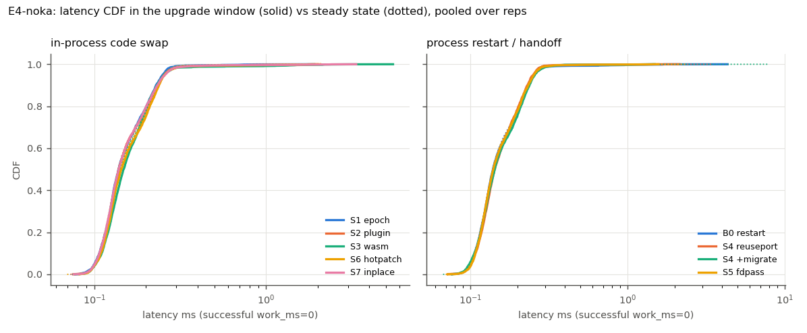

# Cross-solution tables (final campaign)

Mean ± 95% CI half-width (Student t) over repetitions; the run is the unit of replication.
Errors are also given as total failed / total measured requests over all runs.

## Main comparison (E1: 200 req/s, keep-alive, 1 upgrade v1->v2)

| solution | errors (total) | downtime ms | p99 upgrade window ms | upgrade duration ms | state preserved (E1-E4) | rollback (E6 rollback_ok) |
|---|---|---|---|---|---|---|
| b0-naive-restart | 14/17000 | 19.4 ± 2.8 | 0.89 ± 0.41 | 13.3 ± 1.7 | NO (25/25 runs) | 0/5 |
| s1-epoch-swap | 0/17000 | 6.5 ± 1.2 | 0.61 ± 0.17 | 0.7 ± 0.6 | yes | 5/5 |
| s2-plugin | 0/17000 | 7.0 ± 2.3 | 1.04 ± 0.54 | 9.0 ± 2.5 | yes | 5/5 |
| s3-wasm | 0/17000 | 7.8 ± 1.7 | 1.63 ± 1.18 | 299.8 ± 2.8 | yes | 5/5 |
| s4-reuseport | 0/17000 | 7.2 ± 2.6 | 0.77 ± 0.16 | 14.6 ± 1.8 | yes | 5/5 |
| s4-reuseport+migrate | 0/17000 | 6.7 ± 1.0 | 0.70 ± 0.08 | 14.5 ± 1.7 | yes | 5/5 |
| s5-fdpass | 0/17000 | 6.5 ± 1.1 | 0.72 ± 0.07 | 11.8 ± 0.5 | yes | 5/5 |
| s6-hotpatch | 0/17000 | 7.3 ± 1.0 | 0.89 ± 0.32 | 15.5 ± 1.1 | yes | 5/5 |
| s7-inplace | 0/17000 | 6.9 ± 1.0 | 0.70 ± 0.10 | 3893.4 ± 2876.6 | yes | 5/5 |
| k8s-naive | 27/47000 | 169.9 ± 52.6 | 126.58 ± 41.67 | 1464.8 ± 71.4 | NO (5/5 runs) | n/a (not run) |
| k8s-prestop | 1/47000 | 7.1 ± 2.3 | 0.70 ± 0.17 | 1404.1 ± 47.9 | NO (5/5 runs) | n/a (not run) |

## E1

| solution | n | errors (total) | error classes | downtime ms | fail window ms | p99 steady ms | p99 upg ms | p99.9 upg ms | max upg ms | upgrade ms | time to new ver ms | mix ms | resets/regr/dups (sum) | rollback_ok |
|---|---|---|---|---|---|---|---|---|---|---|---|---|---|---|
| b0-naive-restart | 5 | 14/17000 | refused 12, eof 2 | 19.4 ± 2.8 | 14.0 ± 2.8 | 0.84 ± 0.42 | 0.89 ± 0.41 | 1.49 ± 0.87 | 1.6 ± 0.9 | 13.3 ± 1.7 | 26.6 ± 3.8 | 0.0 ± 0.0 | 5/0/6970 |  |
| s1-epoch-swap | 5 | 0/17000 | - | 6.5 ± 1.2 | 0.0 ± 0.0 | 0.72 ± 0.05 | 0.61 ± 0.17 | 0.96 ± 0.54 | 1.0 ± 0.6 | 0.7 ± 0.6 | 10.7 ± 2.3 | 0.0 ± 0.0 | 0/0/0 |  |
| s2-plugin | 5 | 0/17000 | - | 7.0 ± 2.3 | 0.0 ± 0.0 | 0.76 ± 0.09 | 1.04 ± 0.54 | 2.00 ± 2.08 | 2.2 ± 2.4 | 9.0 ± 2.5 | 20.3 ± 5.7 | 0.0 ± 0.0 | 0/0/0 |  |
| s3-wasm | 5 | 0/17000 | - | 7.8 ± 1.7 | 0.0 ± 0.0 | 0.74 ± 0.14 | 1.63 ± 1.18 | 2.84 ± 1.73 | 3.0 ± 1.7 | 299.8 ± 2.8 | 312.6 ± 3.0 | 0.0 ± 0.0 | 0/0/0 |  |
| s4-reuseport | 5 | 0/17000 | - | 7.2 ± 2.6 | 0.0 ± 0.0 | 0.77 ± 0.14 | 0.77 ± 0.16 | 1.94 ± 2.37 | 2.2 ± 2.9 | 14.6 ± 1.8 | 27.4 ± 2.3 | 0.0 ± 0.0 | 0/0/0 |  |
| s4-reuseport+migrate | 5 | 0/17000 | - | 6.7 ± 1.0 | 0.0 ± 0.0 | 0.76 ± 0.12 | 0.70 ± 0.08 | 1.32 ± 1.08 | 1.4 ± 1.3 | 14.5 ± 1.7 | 26.5 ± 0.5 | 0.0 ± 0.0 | 0/0/0 |  |
| s5-fdpass | 5 | 0/17000 | - | 6.5 ± 1.1 | 0.0 ± 0.0 | 0.71 ± 0.07 | 0.72 ± 0.07 | 1.02 ± 0.34 | 1.1 ± 0.4 | 11.8 ± 0.5 | 23.1 ± 2.7 | 0.0 ± 0.0 | 0/0/0 |  |
| s6-hotpatch | 5 | 0/17000 | - | 7.3 ± 1.0 | 0.0 ± 0.0 | 0.79 ± 0.06 | 0.89 ± 0.32 | 1.67 ± 1.39 | 1.8 ± 1.7 | 15.5 ± 1.1 | 26.6 ± 0.2 | 0.0 ± 0.0 | 0/0/0 |  |
| s7-inplace | 5 | 0/17000 | - | 6.9 ± 1.0 | 0.0 ± 0.0 | 0.68 ± 0.02 | 0.70 ± 0.10 | 1.43 ± 0.55 | 2.0 ± 1.1 | 3893.4 ± 2876.6 | 1191.5 ± 405.1 | 3012.9 ± 2590.4 | 0/0/0 |  |
| k8s-naive | 5 | 27/47000 | refused 26, eof 1 | 169.9 ± 52.6 | 12.0 ± 7.1 | 0.83 ± 0.13 | 126.58 ± 41.67 | 158.93 ± 50.38 | 163.3 ± 51.7 | 1464.8 ± 71.4 | 1577.2 ± 58.4 | 0.0 ± 0.0 | 21/2/10181 |  |
| k8s-prestop | 5 | 1/47000 | eof 1 | 7.1 ± 2.3 | 1.0 ± 2.8 | 0.82 ± 0.12 | 0.70 ± 0.17 | 2.59 ± 3.73 | 3.3 ± 5.1 | 1404.1 ± 47.9 | 6021.6 ± 283.9 | 0.0 ± 0.0 | 11/4/16889 |  |

## E2

| solution | n | errors (total) | error classes | downtime ms | fail window ms | p99 steady ms | p99 upg ms | p99.9 upg ms | max upg ms | upgrade ms | time to new ver ms | mix ms | resets/regr/dups (sum) | rollback_ok |
|---|---|---|---|---|---|---|---|---|---|---|---|---|---|---|
| b0-naive-restart | 5 | 843/1785000 | refused 748, reset 16, eof 79 | 8.7 ± 0.8 | 8.0 ± 0.9 | 0.74 ± 0.02 | 0.77 ± 0.06 | 1.59 ± 0.69 | 6.3 ± 11.6 | 8.2 ± 0.8 | 12.5 ± 0.8 | 0.0 ± 0.0 | 5/0/733558 |  |
| s1-epoch-swap | 5 | 0/1785000 | - | 1.6 ± 0.4 | 0.0 ± 0.0 | 0.71 ± 0.04 | 0.74 ± 0.06 | 1.37 ± 0.30 | 2.1 ± 0.7 | 0.4 ± 0.2 | 3.9 ± 0.5 | 0.0 ± 0.0 | 0/0/0 |  |
| s2-plugin | 5 | 0/1785000 | - | 2.0 ± 1.3 | 0.0 ± 0.0 | 0.71 ± 0.04 | 0.70 ± 0.18 | 1.67 ± 1.03 | 2.4 ± 1.3 | 5.0 ± 0.6 | 8.7 ± 0.7 | 0.0 ± 0.0 | 0/0/0 |  |
| s3-wasm | 5 | 0/1785000 | - | 4.0 ± 0.5 | 0.0 ± 0.0 | 0.67 ± 0.05 | 1.50 ± 0.93 | 4.02 ± 1.76 | 5.2 ± 2.0 | 313.4 ± 37.8 | 316.8 ± 37.9 | 0.0 ± 0.0 | 0/0/0 |  |
| s4-reuseport | 5 | 37/1785000 | reset 22, eof 15 | 1.6 ± 0.2 | 0.3 ± 0.1 | 0.72 ± 0.02 | 0.70 ± 0.10 | 1.21 ± 0.23 | 1.7 ± 0.3 | 7.4 ± 0.3 | 10.9 ± 0.4 | 0.0 ± 0.0 | 0/0/0 |  |
| s4-reuseport+migrate | 5 | 58/1785000 | reset 25, eof 33 | 1.9 ± 0.4 | 0.4 ± 0.5 | 0.73 ± 0.02 | 0.77 ± 0.06 | 1.51 ± 0.38 | 2.3 ± 0.7 | 8.2 ± 0.9 | 11.8 ± 0.8 | 0.0 ± 0.0 | 0/0/0 |  |
| s5-fdpass | 5 | 42/1785000 | reset 28, eof 14 | 1.5 ± 0.3 | 0.4 ± 0.2 | 0.73 ± 0.03 | 0.74 ± 0.05 | 1.35 ± 0.27 | 1.8 ± 0.4 | 6.1 ± 0.4 | 9.6 ± 0.3 | 0.0 ± 0.0 | 0/0/0 |  |
| s6-hotpatch | 5 | 0/1785000 | - | 2.7 ± 1.8 | 0.0 ± 0.0 | 0.75 ± 0.06 | 0.82 ± 0.18 | 2.60 ± 1.51 | 3.5 ± 1.9 | 10.1 ± 2.2 | 10.7 ± 0.7 | 0.0 ± 0.0 | 0/0/0 |  |
| s7-inplace | 5 | 0/1785000 | - | 4.1 ± 2.3 | 0.0 ± 0.0 | 0.57 ± 0.07 | 1.12 ± 0.51 | 3.48 ± 1.96 | 4.9 ± 2.4 | 802.0 ± 1.3 | 528.1 ± 23.8 | 599.9 ± 2.1 | 0/0/0 |  |

## E3

| solution | n | errors (total) | error classes | downtime ms | fail window ms | p99 steady ms | p99 upg ms | p99.9 upg ms | max upg ms | upgrade ms | time to new ver ms | mix ms | resets/regr/dups (sum) | rollback_ok |
|---|---|---|---|---|---|---|---|---|---|---|---|---|---|---|
| b0-naive-restart | 5 | 565/17000 | refused 563, eof 2 | 147.3 ± 30.4 | 565.0 ± 9.8 | 0.73 ± 0.10 | 1.20 ± 0.85 | 1.73 ± 1.88 | 1.8 ± 2.0 | 565.4 ± 12.4 | 580.7 ± 9.4 | 0.0 ± 0.0 | 5/0/6418 |  |
| s1-epoch-swap | 5 | 0/17000 | - | 16.1 ± 2.9 | 0.0 ± 0.0 | 0.80 ± 0.10 | 0.76 ± 0.10 | 1.79 ± 0.54 | 2.1 ± 0.6 | 459.3 ± 26.6 | 11.0 ± 0.8 | 457.0 ± 25.7 | 0/0/0 |  |
| s2-plugin | 5 | 0/17000 | - | 16.1 ± 2.7 | 0.0 ± 0.0 | 0.76 ± 0.06 | 0.87 ± 0.24 | 2.10 ± 1.54 | 2.4 ± 2.1 | 459.0 ± 27.2 | 22.9 ± 2.7 | 445.0 ± 25.5 | 0/0/0 |  |
| s3-wasm | 5 | 0/17000 | - | 16.5 ± 2.8 | 0.0 ± 0.0 | 0.75 ± 0.17 | 2.24 ± 1.31 | 3.73 ± 1.21 | 4.2 ± 1.5 | 767.6 ± 28.7 | 307.5 ± 8.2 | 469.5 ± 25.0 | 0/0/0 |  |
| s4-reuseport | 5 | 0/17000 | - | 16.2 ± 2.7 | 0.0 ± 0.0 | 0.68 ± 0.11 | 0.85 ± 0.12 | 1.92 ± 1.00 | 2.2 ± 1.4 | 475.1 ± 46.0 | 26.1 ± 0.9 | 457.2 ± 46.4 | 0/0/0 |  |
| s4-reuseport+migrate | 5 | 0/17000 | - | 16.1 ± 2.6 | 0.0 ± 0.0 | 0.70 ± 0.08 | 0.80 ± 0.10 | 1.30 ± 0.51 | 1.4 ± 0.6 | 476.8 ± 46.0 | 26.3 ± 0.9 | 458.1 ± 45.8 | 0/0/0 |  |
| s5-fdpass | 5 | 0/17000 | - | 16.2 ± 2.6 | 0.0 ± 0.0 | 0.74 ± 0.11 | 0.84 ± 0.12 | 1.27 ± 0.45 | 1.3 ± 0.5 | 468.2 ± 38.4 | 25.0 ± 2.7 | 450.8 ± 37.8 | 0/0/0 |  |
| s6-hotpatch | 5 | 0/17000 | - | 16.2 ± 2.6 | 0.0 ± 0.0 | 0.83 ± 0.12 | 0.76 ± 0.14 | 1.54 ± 0.75 | 1.7 ± 0.9 | 477.1 ± 45.1 | 27.2 ± 2.9 | 456.3 ± 44.7 | 0/0/0 |  |
| s7-inplace | 5 | 0/17000 | - | 17.3 ± 3.4 | 0.0 ± 0.0 | 0.74 ± 0.09 | 0.80 ± 0.28 | 2.40 ± 1.80 | 3.4 ± 3.4 | 3527.8 ± 945.5 | 1374.0 ± 499.1 | 2441.7 ± 624.6 | 0/0/0 |  |

## E4-ka

| solution | n | errors (total) | error classes | downtime ms | fail window ms | p99 steady ms | p99 upg ms | p99.9 upg ms | max upg ms | upgrade ms | time to new ver ms | mix ms | resets/regr/dups (sum) | rollback_ok |
|---|---|---|---|---|---|---|---|---|---|---|---|---|---|---|
| b0-naive-restart | 5 | 326/42500 | refused 326 | 68.0 ± 28.6 | 130.4 ± 36.6 | 0.21 ± 0.01 | 0.23 ± 0.02 | 0.62 ± 0.43 | 0.9 ± 0.8 | 131.1 ± 37.6 | 135.8 ± 37.2 | 0.0 ± 0.0 | 5/0/17155 |  |
| s1-epoch-swap | 5 | 0/42500 | - | 6.4 ± 0.9 | 0.0 ± 0.0 | 0.21 ± 0.01 | 0.20 ± 0.01 | 0.45 ± 0.24 | 0.6 ± 0.3 | 79.6 ± 19.8 | 4.6 ± 1.3 | 78.4 ± 20.6 | 0/0/0 |  |
| s2-plugin | 5 | 0/42500 | - | 6.0 ± 0.0 | 0.0 ± 0.0 | 0.22 ± 0.00 | 0.23 ± 0.01 | 0.46 ± 0.09 | 0.5 ± 0.1 | 93.6 ± 12.6 | 8.8 ± 1.1 | 88.0 ± 13.6 | 0/0/0 |  |
| s3-wasm | 5 | 0/42500 | - | 6.3 ± 0.8 | 0.0 ± 0.0 | 0.22 ± 0.01 | 0.51 ± 0.53 | 2.53 ± 0.65 | 2.8 ± 0.9 | 343.1 ± 42.1 | 289.2 ± 4.8 | 57.3 ± 44.4 | 0/0/0 |  |
| s4-reuseport | 5 | 0/42500 | - | 6.0 ± 0.1 | 0.0 ± 0.0 | 0.21 ± 0.00 | 0.23 ± 0.01 | 0.56 ± 0.52 | 0.7 ± 0.8 | 97.1 ± 11.1 | 10.4 ± 0.9 | 87.3 ± 11.1 | 0/0/0 |  |
| s4-reuseport+migrate | 5 | 2/42500 | reset 1, eof 1 | 6.0 ± 0.1 | 0.8 ± 1.4 | 0.20 ± 0.01 | 0.21 ± 0.00 | 0.39 ± 0.17 | 0.5 ± 0.2 | 97.4 ± 11.1 | 11.4 ± 1.0 | 86.3 ± 12.0 | 0/0/0 |  |
| s5-fdpass | 5 | 0/42500 | - | 6.1 ± 0.1 | 0.0 ± 0.0 | 0.21 ± 0.01 | 0.22 ± 0.01 | 0.37 ± 0.22 | 0.5 ± 0.5 | 95.6 ± 11.6 | 9.8 ± 0.3 | 87.0 ± 11.5 | 0/0/0 |  |
| s6-hotpatch | 5 | 0/42500 | - | 6.4 ± 1.0 | 0.0 ± 0.0 | 0.22 ± 0.01 | 0.23 ± 0.01 | 0.58 ± 0.46 | 0.8 ± 0.9 | 95.5 ± 11.7 | 12.6 ± 2.0 | 84.2 ± 13.2 | 0/0/0 |  |
| s7-inplace | 5 | 0/42500 | - | 7.1 ± 1.9 | 0.0 ± 0.0 | 0.22 ± 0.02 | 0.22 ± 0.01 | 1.33 ± 2.66 | 2.6 ± 3.5 | 1438.4 ± 388.1 | 760.4 ± 286.4 | 952.8 ± 193.9 | 0/0/0 |  |

## E4-noka

| solution | n | errors (total) | error classes | downtime ms | fail window ms | p99 steady ms | p99 upg ms | p99.9 upg ms | max upg ms | upgrade ms | time to new ver ms | mix ms | resets/regr/dups (sum) | rollback_ok |
|---|---|---|---|---|---|---|---|---|---|---|---|---|---|---|
| b0-naive-restart | 5 | 365/42500 | refused 362, reset 2, eof 1 | 72.6 ± 17.8 | 145.6 ± 2.1 | 0.30 ± 0.02 | 0.40 ± 0.19 | 1.56 ± 0.96 | 2.0 ± 1.6 | 146.4 ± 1.4 | 151.3 ± 1.1 | 0.0 ± 0.0 | 5/0/17118 |  |
| s1-epoch-swap | 5 | 0/42500 | - | 6.1 ± 0.1 | 0.0 ± 0.0 | 0.31 ± 0.02 | 0.33 ± 0.09 | 0.79 ± 0.51 | 1.0 ± 0.8 | 83.5 ± 22.7 | 5.3 ± 1.0 | 81.9 ± 23.3 | 0/0/0 |  |
| s2-plugin | 5 | 0/42500 | - | 6.1 ± 0.1 | 0.0 ± 0.0 | 0.31 ± 0.01 | 0.37 ± 0.13 | 1.31 ± 0.53 | 1.5 ± 0.6 | 93.8 ± 12.6 | 8.8 ± 1.0 | 88.1 ± 12.6 | 0/0/0 |  |
| s3-wasm | 5 | 0/42500 | - | 6.3 ± 0.7 | 0.0 ± 0.0 | 0.30 ± 0.01 | 0.68 ± 0.62 | 2.38 ± 1.16 | 3.0 ± 1.9 | 371.6 ± 39.1 | 309.2 ± 9.2 | 65.7 ± 35.0 | 0/0/0 |  |
| s4-reuseport | 5 | 0/42500 | - | 6.0 ± 0.1 | 0.0 ± 0.0 | 0.30 ± 0.01 | 0.29 ± 0.01 | 0.88 ± 0.51 | 1.2 ± 0.8 | 96.9 ± 11.0 | 10.9 ± 1.2 | 86.5 ± 11.8 | 0/0/0 |  |
| s4-reuseport+migrate | 5 | 0/42500 | - | 6.5 ± 1.0 | 0.0 ± 0.0 | 0.31 ± 0.01 | 0.32 ± 0.03 | 0.83 ± 0.55 | 1.0 ± 0.7 | 98.0 ± 11.6 | 10.7 ± 0.8 | 86.9 ± 12.1 | 0/0/0 |  |
| s5-fdpass | 5 | 0/42500 | - | 6.1 ± 0.1 | 0.0 ± 0.0 | 0.31 ± 0.01 | 0.30 ± 0.03 | 0.89 ± 0.65 | 1.0 ± 0.6 | 97.8 ± 11.9 | 9.7 ± 1.0 | 88.2 ± 11.5 | 0/0/0 |  |
| s6-hotpatch | 5 | 0/42500 | - | 6.1 ± 0.0 | 0.0 ± 0.0 | 0.31 ± 0.02 | 0.40 ± 0.23 | 1.43 ± 0.51 | 1.7 ± 0.4 | 96.5 ± 12.1 | 11.4 ± 0.8 | 85.5 ± 12.9 | 0/0/0 |  |
| s7-inplace | 5 | 0/42500 | - | 6.5 ± 1.1 | 0.0 ± 0.0 | 0.31 ± 0.02 | 0.36 ± 0.07 | 1.74 ± 0.95 | 2.6 ± 1.2 | 1360.8 ± 335.6 | 671.0 ± 150.7 | 990.1 ± 379.2 | 0/0/0 |  |

## E5

| solution | n | errors (total) | error classes | downtime ms | fail window ms | p99 steady ms | p99 upg ms | p99.9 upg ms | max upg ms | upgrade ms | time to new ver ms | mix ms | resets/regr/dups (sum) | rollback_ok |
|---|---|---|---|---|---|---|---|---|---|---|---|---|---|---|
| b0-naive-restart | 2 | 117/21000 | refused 117 | 30.6 ± 2.0 | 20.0 ± 0.0 | 1.21 ± 0.51 | 1.32 ± 0.01 | 2.23 ± 1.76 | 6.8 ± 5.8 | 12.3 ± 2.5 | 27.4 ± 0.4 | 0.0 ± 0.0 | 100/0/19879 |  |
| s1-epoch-swap | 2 | 0/21000 | - | 17.2 ± 17.1 | 0.0 ± 0.0 | 1.45 ± 2.16 | 1.24 ± 1.01 | 3.25 ± 1.72 | 8.3 ± 25.3 | 0.8 ± 0.5 | 15.5 ± 1.1 | 0.0 ± 0.0 | 0/0/0 |  |
| s2-plugin | 2 | 0/21000 | - | 15.2 ± 8.9 | 0.0 ± 0.0 | 0.83 ± 0.75 | 1.30 ± 0.53 | 3.17 ± 5.69 | 6.1 ± 2.6 | 23.7 ± 2.6 | 39.0 ± 1.0 | 0.0 ± 0.0 | 0/0/0 |  |
| s3-wasm | 2 | 0/21000 | - | 15.7 ± 5.9 | 0.0 ± 0.0 | 1.33 ± 5.62 | 1.38 ± 0.77 | 3.84 ± 3.11 | 6.3 ± 5.1 | 276.0 ± 9.1 | 289.1 ± 4.9 | 0.0 ± 0.0 | 0/0/0 |  |
| s4-reuseport | 2 | 2/21000 | eof 2 | 16.9 ± 39.4 | 5.0 ± 63.5 | 0.83 ± 2.45 | 1.04 ± 0.68 | 2.20 ± 0.79 | 4.5 ± 1.4 | 14.0 ± 2.1 | 26.0 ± 3.6 | 0.0 ± 0.0 | 0/0/0 |  |
| s5-fdpass | 2 | 0/21000 | - | 18.5 ± 17.5 | 0.0 ± 0.0 | 1.01 ± 3.61 | 1.12 ± 3.24 | 2.10 ± 2.77 | 8.8 ± 17.2 | 11.1 ± 0.8 | 25.2 ± 2.6 | 0.0 ± 0.0 | 0/0/0 |  |
| s6-hotpatch | 2 | 0/21000 | - | 14.9 ± 15.1 | 0.0 ± 0.0 | 0.95 ± 0.71 | 0.93 ± 0.06 | 2.68 ± 0.99 | 5.3 ± 14.1 | 8.1 ± 7.8 | 12.0 ± 12.6 | 0.0 ± 0.0 | 0/0/0 |  |
| s7-inplace | 2 | 0/148400 | - | 27.0 ± 22.5 | 0.0 ± 0.0 | 1.26 ± 0.23 | 1.22 ± 1.95 | 3.18 ± 3.87 | 18.2 ± 27.3 | 6131.6 ± 25.5 | 2177.3 ± 1137.3 | 4207.5 ± 1127.1 | 0/0/0 |  |

## E6

| solution | n | errors (total) | error classes | downtime ms | fail window ms | p99 steady ms | p99 upg ms | p99.9 upg ms | max upg ms | upgrade ms | time to new ver ms | mix ms | resets/regr/dups (sum) | rollback_ok |
|---|---|---|---|---|---|---|---|---|---|---|---|---|---|---|
| b0-naive-restart | 5 | 9984/17000 | refused 9984 | 6.1 ± 0.5 | 9979.0 ± 2.8 | 0.85 ± 0.23 | 0.46 ± 0.03 | 0.46 ± 0.03 | 0.5 ± 0.0 | n/a | n/a | n/a | 0/0/0 | 0/5 |
| s1-epoch-swap | 5 | 0/17000 | - | 6.6 ± 1.3 | 0.0 ± 0.0 | 3.19 ± 7.01 | 1.08 ± 1.21 | 1.29 ± 1.35 | 1.3 ± 1.4 | n/a | n/a | n/a | 0/0/0 | 5/5 |
| s2-plugin | 5 | 0/17000 | - | 6.4 ± 0.5 | 0.0 ± 0.0 | 0.75 ± 0.06 | 0.65 ± 0.15 | 1.07 ± 0.76 | 1.1 ± 0.9 | n/a | n/a | n/a | 0/0/0 | 5/5 |
| s3-wasm | 5 | 0/17000 | - | 8.3 ± 1.2 | 0.0 ± 0.0 | 0.76 ± 0.08 | 1.82 ± 0.73 | 3.17 ± 1.42 | 3.3 ± 1.5 | n/a | n/a | n/a | 0/0/0 | 5/5 |
| s4-reuseport | 5 | 0/17000 | - | 8.9 ± 4.4 | 0.0 ± 0.0 | 0.75 ± 0.16 | 0.66 ± 0.07 | 2.79 ± 2.38 | 3.5 ± 3.1 | n/a | n/a | n/a | 0/0/0 | 5/5 |
| s4-reuseport+migrate | 5 | 0/17000 | - | 6.7 ± 0.6 | 0.0 ± 0.0 | 0.79 ± 0.21 | 0.67 ± 0.09 | 1.25 ± 0.44 | 1.6 ± 0.9 | n/a | n/a | n/a | 0/0/0 | 5/5 |
| s5-fdpass | 5 | 0/17000 | - | 9.3 ± 5.2 | 0.0 ± 0.0 | 0.69 ± 0.09 | 0.72 ± 0.13 | 3.10 ± 4.42 | 4.0 ± 5.7 | n/a | n/a | n/a | 0/0/0 | 5/5 |
| s6-hotpatch | 5 | 0/17000 | - | 8.2 ± 2.4 | 0.0 ± 0.0 | 0.79 ± 0.09 | 0.75 ± 0.18 | 1.78 ± 1.20 | 2.0 ± 1.4 | n/a | n/a | n/a | 0/0/0 | 5/5 |
| s7-inplace | 5 | 0/17000 | - | 7.1 ± 1.4 | 0.0 ± 0.0 | 0.67 ± 0.07 | 0.87 ± 0.54 | 2.09 ± 1.13 | 2.3 ± 1.2 | n/a | n/a | n/a | 0/0/0 | 5/5 |
| s4-reuseport+crash | 5 | 0/17000 | - | 7.5 ± 3.6 | 0.0 ± 0.0 | 0.74 ± 0.10 | 0.81 ± 0.38 | 2.33 ± 3.36 | 2.6 ± 3.9 | n/a | n/a | n/a | 0/0/0 | 5/5 |
| s5-fdpass+crash | 5 | 1/17000 | reset 1 | 7.4 ± 2.5 | 1.0 ± 2.8 | 0.66 ± 0.09 | 0.66 ± 0.08 | 1.81 ± 2.48 | 2.1 ± 3.0 | n/a | n/a | n/a | 0/0/0 | 4/5 |
| s7-inplace+tampered | 5 | 0/17000 | - | 6.6 ± 0.8 | 0.0 ± 0.0 | 0.70 ± 0.04 | 0.65 ± 0.04 | 0.77 ± 0.10 | 0.8 ± 0.1 | n/a | n/a | n/a | 0/0/0 | 5/5 |

## State continuity (all experiments; sums over runs)

resets / regressions / duplicate counts / lost increments (lost only defined without reset). A state-preserving upgrade shows 0/0/0.

| solution | E1 | E2 | E3 | E4-ka | E4-noka | E5 | E6 |
|---|---|---|---|---|---|---|---|
| b0-naive-restart | 5/0/6970/n/a | 5/0/733558/n/a | 5/0/6418/n/a | 5/0/17155/n/a | 5/0/17118/n/a | 100/0/19879/n/a | 0/0/0/0 |
| s1-epoch-swap | 0/0/0/0 | 0/0/0/0 | 0/0/0/49 | 0/0/0/16 | 0/0/0/16 | 0/0/0/0 | 0/0/0/0 |
| s2-plugin | 0/0/0/0 | 0/0/0/0 | 0/0/0/49 | 0/0/0/16 | 0/0/0/16 | 0/0/0/0 | 0/0/0/0 |
| s3-wasm | 0/0/0/0 | 0/0/0/0 | 0/0/0/49 | 0/0/0/16 | 0/0/0/16 | 0/0/0/0 | 0/0/0/0 |
| s4-reuseport | 0/0/0/0 | 0/0/0/3 | 0/0/0/49 | 0/0/0/16 | 0/0/0/16 | 0/0/0/0 | 0/0/0/0 |
| s4-reuseport+migrate | 0/0/0/0 | 0/0/0/5 | 0/0/0/49 | 0/0/0/16 | 0/0/0/16 |  | 0/0/0/0 |
| s5-fdpass | 0/0/0/0 | 0/0/0/2 | 0/0/0/49 | 0/0/0/16 | 0/0/0/16 | 0/0/0/0 | 0/0/0/0 |
| s6-hotpatch | 0/0/0/0 | 0/0/0/0 | 0/0/0/0 | 0/0/0/0 | 0/0/0/0 | 0/0/0/0 | 0/0/0/0 |
| s7-inplace | 0/0/0/0 | 0/0/0/0 | 0/0/0/49 | 0/0/0/16 | 0/0/0/16 | 0/0/0/0 | 0/0/0/0 |
| k8s-naive | 21/2/10181/n/a |  |  |  |  |  |  |
| k8s-prestop | 11/4/16889/n/a |  |  |  |  |  |  |
| s4-reuseport+crash |  |  |  |  |  |  | 0/0/0/0 |
| s5-fdpass+crash |  |  |  |  |  |  | 0/0/0/0 |
| s7-inplace+tampered |  |  |  |  |  |  | 0/0/0/0 |

## Resources across repeated upgrades (E5)

| solution | n | upgrades done/failed per run | RSS steady MiB | RSS end MiB | RSS growth MiB | RSS slope KiB/upgrade | max procs | errors (total) | upgrade ms |
|---|---|---|---|---|---|---|---|---|---|
| b0-naive-restart | 2 | 50/0; 50/0 | 10.3 ± 0.9 | 10.3 ± 0.2 | -0.0 ± 0.6 | 0.8 ± 12.3 | 1 | 117/21000 | 12.3 ± 2.5 |
| s1-epoch-swap | 2 | 50/0; 50/0 | 10.5 ± 0.7 | 13.5 ± 0.5 | 3.0 ± 0.2 | 24.7 ± 39.2 | 1 | 0/21000 | 0.8 ± 0.5 |
| s2-plugin | 2 | 50/0; 50/0 | 17.1 ± 1.8 | 211.1 ± 1.2 | 194.0 ± 3.0 | 3990.3 ± 14.7 | 1 | 0/21000 | 23.7 ± 2.6 |
| s3-wasm | 2 | 50/0; 50/0 | 49.8 ± 12.0 | 97.0 ± 25.6 | 47.2 ± 37.6 | 171.9 ± 82.6 | 1 | 0/21000 | 276.0 ± 9.1 |
| s4-reuseport | 2 | 50/0; 50/0 | 10.7 ± 0.0 | 10.9 ± 0.2 | 0.2 ± 0.3 | -8.3 ± 1.3 | 1 | 2/21000 | 14.0 ± 2.1 |
| s5-fdpass | 2 | 50/0; 50/0 | 10.7 ± 0.1 | 11.0 ± 0.0 | 0.3 ± 0.1 | 0.7 ± 113.9 | 1 | 0/21000 | 11.1 ± 0.8 |
| s6-hotpatch | 2 | 50/0; 50/0 | 13.0 ± 0.1 | 19.1 ± 4.0 | 6.2 ± 3.9 | 3.0 ± 45.9 | 1 | 0/21000 | 8.1 ± 7.8 |
| s7-inplace | 2 | 49/0; 49/0 | 77.5 ± 1.7 | 180.7 ± 304.6 | 103.2 ± 302.8 | -66.6 ± 3149.2 | 1 | 0/148400 | 6131.6 ± 25.5 |

---

# Per-experiment summary (all metrics)

Generated by `bench/analysis/analyze.py`. Values: mean ± 95% CI half-width (Student t) over repetitions;
`n/a` = not applicable / not observable. Metric definitions: `docs/evaluation-methodology.md`.

## E1

Repetitions: b0-naive-restart: n=5, k8s-naive: n=5, k8s-prestop: n=5, s1-epoch-swap: n=5, s2-plugin: n=5, s3-wasm: n=5, s4-reuseport: n=5, s4-reuseport+migrate: n=5, s5-fdpass: n=5, s6-hotpatch: n=5, s7-inplace: n=5

| metric | b0-naive-restart | k8s-naive | k8s-prestop | s1-epoch-swap | s2-plugin | s3-wasm | s4-reuseport | s4-reuseport+migrate | s5-fdpass | s6-hotpatch | s7-inplace |
|---|---|---|---|---|---|---|---|---|---|---|---|
| error rate | 8.24e-04 ± 1.63e-04 | 5.74e-04 ± 2.74e-04 | 2.13e-05 ± 5.91e-05 | 0.00e+00 ± 0.00e+00 | 0.00e+00 ± 0.00e+00 | 0.00e+00 ± 0.00e+00 | 0.00e+00 ± 0.00e+00 | 0.00e+00 ± 0.00e+00 | 0.00e+00 ± 0.00e+00 | 0.00e+00 ± 0.00e+00 | 0.00e+00 ± 0.00e+00 |
| errors | 2.8 ± 0.6 | 5.4 ± 2.6 | 0.2 ± 0.6 | 0.0 ± 0.0 | 0.0 ± 0.0 | 0.0 ± 0.0 | 0.0 ± 0.0 | 0.0 ± 0.0 | 0.0 ± 0.0 | 0.0 ± 0.0 | 0.0 ± 0.0 |
| downtime ms | 19.4 ± 2.8 | 169.9 ± 52.6 | 7.1 ± 2.3 | 6.5 ± 1.2 | 7.0 ± 2.3 | 7.8 ± 1.7 | 7.2 ± 2.6 | 6.7 ± 1.0 | 6.5 ± 1.1 | 7.3 ± 1.0 | 6.9 ± 1.0 |
| steady max gap ms | 9.6 ± 4.8 | 9.4 ± 4.8 | 8.7 ± 1.8 | 7.2 ± 0.8 | 10.2 ± 4.5 | 8.8 ± 3.0 | 7.6 ± 1.8 | 8.2 ± 2.4 | 8.7 ± 2.6 | 8.0 ± 1.9 | 6.8 ± 0.3 |
| fail window ms | 14.0 ± 2.8 | 12.0 ± 7.1 | 1.0 ± 2.8 | 0.0 ± 0.0 | 0.0 ± 0.0 | 0.0 ± 0.0 | 0.0 ± 0.0 | 0.0 ± 0.0 | 0.0 ± 0.0 | 0.0 ± 0.0 | 0.0 ± 0.0 |
| refused window ms | 12.0 ± 3.4 | 334.0 ± 316.5 | 0.0 ± 0.0 | 0.0 ± 0.0 | 0.0 ± 0.0 | 0.0 ± 0.0 | 0.0 ± 0.0 | 0.0 ± 0.0 | 0.0 ± 0.0 | 0.0 ± 0.0 | 0.0 ± 0.0 |
| p99 steady ms | 0.84 ± 0.42 | 0.83 ± 0.13 | 0.82 ± 0.12 | 0.72 ± 0.05 | 0.76 ± 0.09 | 0.74 ± 0.14 | 0.77 ± 0.14 | 0.76 ± 0.12 | 0.71 ± 0.07 | 0.79 ± 0.06 | 0.68 ± 0.02 |
| p99 upg ms | 0.89 ± 0.41 | 126.58 ± 41.67 | 0.70 ± 0.17 | 0.61 ± 0.17 | 1.04 ± 0.54 | 1.63 ± 1.18 | 0.77 ± 0.16 | 0.70 ± 0.08 | 0.72 ± 0.07 | 0.89 ± 0.32 | 0.70 ± 0.10 |
| p99.9 upg ms | 1.49 ± 0.87 | 158.93 ± 50.38 | 2.59 ± 3.73 | 0.96 ± 0.54 | 2.00 ± 2.08 | 2.84 ± 1.73 | 1.94 ± 2.37 | 1.32 ± 1.08 | 1.02 ± 0.34 | 1.67 ± 1.39 | 1.43 ± 0.55 |
| max upg ms | 1.6 ± 0.9 | 163.3 ± 51.7 | 3.3 ± 5.1 | 1.0 ± 0.6 | 2.2 ± 2.4 | 3.0 ± 1.7 | 2.2 ± 2.9 | 1.4 ± 1.3 | 1.1 ± 0.4 | 1.8 ± 1.7 | 2.0 ± 1.1 |
| upgrade ms | 13.3 ± 1.7 | 1464.8 ± 71.4 | 1404.1 ± 47.9 | 0.7 ± 0.6 | 9.0 ± 2.5 | 299.8 ± 2.8 | 14.6 ± 1.8 | 14.5 ± 1.7 | 11.8 ± 0.5 | 15.5 ± 1.1 | 3893.4 ± 2876.6 |
| mix ms | 0.0 ± 0.0 | 0.0 ± 0.0 | 0.0 ± 0.0 | 0.0 ± 0.0 | 0.0 ± 0.0 | 0.0 ± 0.0 | 0.0 ± 0.0 | 0.0 ± 0.0 | 0.0 ± 0.0 | 0.0 ± 0.0 | 3012.9 ± 2590.4 |
| resets | 1.0 ± 0.0 | 4.2 ± 5.4 | 2.2 ± 1.0 | 0.0 ± 0.0 | 0.0 ± 0.0 | 0.0 ± 0.0 | 0.0 ± 0.0 | 0.0 ± 0.0 | 0.0 ± 0.0 | 0.0 ± 0.0 | 0.0 ± 0.0 |
| dups | 1394.0 ± 0.9 | 2036.2 ± 645.3 | 3377.8 ± 1115.5 | 0.0 ± 0.0 | 0.0 ± 0.0 | 0.0 ± 0.0 | 0.0 ± 0.0 | 0.0 ± 0.0 | 0.0 ± 0.0 | 0.0 ± 0.0 | 0.0 ± 0.0 |
| RSS growth MiB | 0.19 ± 0.19 | n/a | n/a | 0.42 ± 0.09 | 4.76 ± 0.18 | 20.34 ± 4.09 | 0.37 ± 0.27 | 0.48 ± 0.15 | 0.37 ± 0.13 | 3.76 ± 0.42 | 56.45 ± 4.29 |
| client lag p99 ms | 0.20 ± 0.17 | 0.22 ± 0.32 | 0.23 ± 0.12 | 0.14 ± 0.07 | 0.23 ± 0.15 | 0.23 ± 0.17 | 0.23 ± 0.19 | 0.17 ± 0.14 | 0.22 ± 0.09 | 0.29 ± 0.22 | 0.13 ± 0.07 |
| versions seen | v1 v2 | v1 v2 | v1 v2 | v1 v2 | v1 v2 | v1 v2 | v1 v2 | v1 v2 | v1 v2 | v1 v2 | v1 v2 |

## E2

Repetitions: b0-naive-restart: n=5, s1-epoch-swap: n=5, s2-plugin: n=5, s3-wasm: n=5, s4-reuseport: n=5, s4-reuseport+migrate: n=5, s5-fdpass: n=5, s6-hotpatch: n=5, s7-inplace: n=5

| metric | b0-naive-restart | s1-epoch-swap | s2-plugin | s3-wasm | s4-reuseport | s4-reuseport+migrate | s5-fdpass | s6-hotpatch | s7-inplace |
|---|---|---|---|---|---|---|---|---|---|
| error rate | 4.72e-04 ± 5.47e-05 | 0.00e+00 ± 0.00e+00 | 0.00e+00 ± 0.00e+00 | 0.00e+00 ± 0.00e+00 | 2.07e-05 ± 6.32e-06 | 3.25e-05 ± 3.02e-05 | 2.35e-05 ± 6.78e-06 | 0.00e+00 ± 0.00e+00 | 0.00e+00 ± 0.00e+00 |
| errors | 168.6 ± 19.5 | 0.0 ± 0.0 | 0.0 ± 0.0 | 0.0 ± 0.0 | 7.4 ± 2.3 | 11.6 ± 10.8 | 8.4 ± 2.4 | 0.0 ± 0.0 | 0.0 ± 0.0 |
| downtime ms | 8.7 ± 0.8 | 1.6 ± 0.4 | 2.0 ± 1.3 | 4.0 ± 0.5 | 1.6 ± 0.2 | 1.9 ± 0.4 | 1.5 ± 0.3 | 2.7 ± 1.8 | 4.1 ± 2.3 |
| steady max gap ms | 2.1 ± 1.2 | 1.9 ± 0.5 | 1.9 ± 0.8 | 2.6 ± 1.5 | 2.1 ± 0.6 | 2.4 ± 1.3 | 2.0 ± 0.2 | 2.6 ± 1.2 | 2.4 ± 1.3 |
| fail window ms | 8.0 ± 0.9 | 0.0 ± 0.0 | 0.0 ± 0.0 | 0.0 ± 0.0 | 0.3 ± 0.1 | 0.4 ± 0.5 | 0.4 ± 0.2 | 0.0 ± 0.0 | 0.0 ± 0.0 |
| refused window ms | 7.1 ± 0.5 | 0.0 ± 0.0 | 0.0 ± 0.0 | 0.0 ± 0.0 | 0.0 ± 0.0 | 0.0 ± 0.0 | 0.0 ± 0.0 | 0.0 ± 0.0 | 0.0 ± 0.0 |
| p99 steady ms | 0.74 ± 0.02 | 0.71 ± 0.04 | 0.71 ± 0.04 | 0.67 ± 0.05 | 0.72 ± 0.02 | 0.73 ± 0.02 | 0.73 ± 0.03 | 0.75 ± 0.06 | 0.57 ± 0.07 |
| p99 upg ms | 0.77 ± 0.06 | 0.74 ± 0.06 | 0.70 ± 0.18 | 1.50 ± 0.93 | 0.70 ± 0.10 | 0.77 ± 0.06 | 0.74 ± 0.05 | 0.82 ± 0.18 | 1.12 ± 0.51 |
| p99.9 upg ms | 1.59 ± 0.69 | 1.37 ± 0.30 | 1.67 ± 1.03 | 4.02 ± 1.76 | 1.21 ± 0.23 | 1.51 ± 0.38 | 1.35 ± 0.27 | 2.60 ± 1.51 | 3.48 ± 1.96 |
| max upg ms | 6.3 ± 11.6 | 2.1 ± 0.7 | 2.4 ± 1.3 | 5.2 ± 2.0 | 1.7 ± 0.3 | 2.3 ± 0.7 | 1.8 ± 0.4 | 3.5 ± 1.9 | 4.9 ± 2.4 |
| upgrade ms | 8.2 ± 0.8 | 0.4 ± 0.2 | 5.0 ± 0.6 | 313.4 ± 37.8 | 7.4 ± 0.3 | 8.2 ± 0.9 | 6.1 ± 0.4 | 10.1 ± 2.2 | 802.0 ± 1.3 |
| mix ms | 0.0 ± 0.0 | 0.0 ± 0.0 | 0.0 ± 0.0 | 0.0 ± 0.0 | 0.0 ± 0.0 | 0.0 ± 0.0 | 0.0 ± 0.0 | 0.0 ± 0.0 | 599.9 ± 2.1 |
| resets | 1.0 ± 0.0 | 0.0 ± 0.0 | 0.0 ± 0.0 | 0.0 ± 0.0 | 0.0 ± 0.0 | 0.0 ± 0.0 | 0.0 ± 0.0 | 0.0 ± 0.0 | 0.0 ± 0.0 |
| dups | 146711.6 ± 18.9 | 0.0 ± 0.0 | 0.0 ± 0.0 | 0.0 ± 0.0 | 0.0 ± 0.0 | 0.0 ± 0.0 | 0.0 ± 0.0 | 0.0 ± 0.0 | 0.0 ± 0.0 |
| RSS growth MiB | -0.68 ± 1.20 | 0.30 ± 0.97 | 4.47 ± 0.38 | 4.79 ± 38.32 | -0.26 ± 1.10 | -1.35 ± 1.16 | 0.43 ± 1.97 | 4.12 ± 1.26 | 5.01 ± 16.24 |
| client lag p99 ms | 0.02 ± 0.00 | 0.02 ± 0.00 | 0.02 ± 0.00 | 0.02 ± 0.00 | 0.02 ± 0.00 | 0.02 ± 0.00 | 0.02 ± 0.00 | 0.02 ± 0.00 | 0.02 ± 0.00 |
| versions seen | v1 v2 | v1 v2 | v1 v2 | v1 v2 | v1 v2 | v1 v2 | v1 v2 | v1 v2 | v1 v2 |

## E3

Repetitions: b0-naive-restart: n=5, s1-epoch-swap: n=5, s2-plugin: n=5, s3-wasm: n=5, s4-reuseport: n=5, s4-reuseport+migrate: n=5, s5-fdpass: n=5, s6-hotpatch: n=5, s7-inplace: n=5

| metric | b0-naive-restart | s1-epoch-swap | s2-plugin | s3-wasm | s4-reuseport | s4-reuseport+migrate | s5-fdpass | s6-hotpatch | s7-inplace |
|---|---|---|---|---|---|---|---|---|---|
| error rate | 3.32e-02 ± 5.77e-04 | 0.00e+00 ± 0.00e+00 | 0.00e+00 ± 0.00e+00 | 0.00e+00 ± 0.00e+00 | 0.00e+00 ± 0.00e+00 | 0.00e+00 ± 0.00e+00 | 0.00e+00 ± 0.00e+00 | 0.00e+00 ± 0.00e+00 | 0.00e+00 ± 0.00e+00 |
| errors | 113.0 ± 2.0 | 0.0 ± 0.0 | 0.0 ± 0.0 | 0.0 ± 0.0 | 0.0 ± 0.0 | 0.0 ± 0.0 | 0.0 ± 0.0 | 0.0 ± 0.0 | 0.0 ± 0.0 |
| downtime ms | 147.3 ± 30.4 | 16.1 ± 2.9 | 16.1 ± 2.7 | 16.5 ± 2.8 | 16.2 ± 2.7 | 16.1 ± 2.6 | 16.2 ± 2.6 | 16.2 ± 2.6 | 17.3 ± 3.4 |
| steady max gap ms | 20.2 ± 4.5 | 20.2 ± 4.3 | 20.1 ± 4.2 | 20.2 ± 4.3 | 20.2 ± 4.4 | 20.2 ± 4.6 | 20.2 ± 4.4 | 20.3 ± 4.5 | 20.4 ± 4.0 |
| fail window ms | 565.0 ± 9.8 | 0.0 ± 0.0 | 0.0 ± 0.0 | 0.0 ± 0.0 | 0.0 ± 0.0 | 0.0 ± 0.0 | 0.0 ± 0.0 | 0.0 ± 0.0 | 0.0 ± 0.0 |
| refused window ms | 563.0 ± 12.1 | 0.0 ± 0.0 | 0.0 ± 0.0 | 0.0 ± 0.0 | 0.0 ± 0.0 | 0.0 ± 0.0 | 0.0 ± 0.0 | 0.0 ± 0.0 | 0.0 ± 0.0 |
| p99 steady ms | 0.73 ± 0.10 | 0.80 ± 0.10 | 0.76 ± 0.06 | 0.75 ± 0.17 | 0.68 ± 0.11 | 0.70 ± 0.08 | 0.74 ± 0.11 | 0.83 ± 0.12 | 0.74 ± 0.09 |
| p99 upg ms | 1.20 ± 0.85 | 0.76 ± 0.10 | 0.87 ± 0.24 | 2.24 ± 1.31 | 0.85 ± 0.12 | 0.80 ± 0.10 | 0.84 ± 0.12 | 0.76 ± 0.14 | 0.80 ± 0.28 |
| p99.9 upg ms | 1.73 ± 1.88 | 1.79 ± 0.54 | 2.10 ± 1.54 | 3.73 ± 1.21 | 1.92 ± 1.00 | 1.30 ± 0.51 | 1.27 ± 0.45 | 1.54 ± 0.75 | 2.40 ± 1.80 |
| max upg ms | 1.8 ± 2.0 | 2.1 ± 0.6 | 2.4 ± 2.1 | 4.2 ± 1.5 | 2.2 ± 1.4 | 1.4 ± 0.6 | 1.3 ± 0.5 | 1.7 ± 0.9 | 3.4 ± 3.4 |
| upgrade ms | 565.4 ± 12.4 | 459.3 ± 26.6 | 459.0 ± 27.2 | 767.6 ± 28.7 | 475.1 ± 46.0 | 476.8 ± 46.0 | 468.2 ± 38.4 | 477.1 ± 45.1 | 3527.8 ± 945.5 |
| mix ms | 0.0 ± 0.0 | 457.0 ± 25.7 | 445.0 ± 25.5 | 469.5 ± 25.0 | 457.2 ± 46.4 | 458.1 ± 45.8 | 450.8 ± 37.8 | 456.3 ± 44.7 | 2441.7 ± 624.6 |
| resets | 1.0 ± 0.0 | 0.0 ± 0.0 | 0.0 ± 0.0 | 0.0 ± 0.0 | 0.0 ± 0.0 | 0.0 ± 0.0 | 0.0 ± 0.0 | 0.0 ± 0.0 | 0.0 ± 0.0 |
| dups | 1283.6 ± 2.3 | 0.0 ± 0.0 | 0.0 ± 0.0 | 0.0 ± 0.0 | 0.0 ± 0.0 | 0.0 ± 0.0 | 0.0 ± 0.0 | 0.0 ± 0.0 | 0.0 ± 0.0 |
| RSS growth MiB | 0.07 ± 0.13 | 0.41 ± 0.34 | 4.62 ± 0.49 | 25.27 ± 1.17 | 0.29 ± 0.08 | 0.27 ± 0.13 | 0.23 ± 0.07 | 3.89 ± 0.29 | 57.91 ± 8.70 |
| client lag p99 ms | 0.12 ± 0.06 | 0.36 ± 0.10 | 0.22 ± 0.16 | 0.17 ± 0.18 | 0.12 ± 0.06 | 0.18 ± 0.17 | 0.13 ± 0.10 | 2.13 ± 5.20 | 0.17 ± 0.19 |
| versions seen | v1 v2 | v1 v2 | v1 v2 | v1 v2 | v1 v2 | v1 v2 | v1 v2 | v1 v2 | v1 v2 |

## E4-ka

Repetitions: b0-naive-restart: n=5, s1-epoch-swap: n=5, s2-plugin: n=5, s3-wasm: n=5, s4-reuseport: n=5, s4-reuseport+migrate: n=5, s5-fdpass: n=5, s6-hotpatch: n=5, s7-inplace: n=5

| metric | b0-naive-restart | s1-epoch-swap | s2-plugin | s3-wasm | s4-reuseport | s4-reuseport+migrate | s5-fdpass | s6-hotpatch | s7-inplace |
|---|---|---|---|---|---|---|---|---|---|
| error rate | 7.67e-03 ± 2.15e-03 | 0.00e+00 ± 0.00e+00 | 0.00e+00 ± 0.00e+00 | 0.00e+00 ± 0.00e+00 | 0.00e+00 ± 0.00e+00 | 4.71e-05 ± 8.00e-05 | 0.00e+00 ± 0.00e+00 | 0.00e+00 ± 0.00e+00 | 0.00e+00 ± 0.00e+00 |
| errors | 65.2 ± 18.3 | 0.0 ± 0.0 | 0.0 ± 0.0 | 0.0 ± 0.0 | 0.0 ± 0.0 | 0.4 ± 0.7 | 0.0 ± 0.0 | 0.0 ± 0.0 | 0.0 ± 0.0 |
| downtime ms | 68.0 ± 28.6 | 6.4 ± 0.9 | 6.0 ± 0.0 | 6.3 ± 0.8 | 6.0 ± 0.1 | 6.0 ± 0.1 | 6.1 ± 0.1 | 6.4 ± 1.0 | 7.1 ± 1.9 |
| steady max gap ms | 6.1 ± 0.1 | 6.1 ± 0.1 | 6.1 ± 0.1 | 6.1 ± 0.1 | 6.1 ± 0.1 | 6.1 ± 0.0 | 6.1 ± 0.1 | 6.1 ± 0.1 | 6.1 ± 0.0 |
| fail window ms | 130.4 ± 36.6 | 0.0 ± 0.0 | 0.0 ± 0.0 | 0.0 ± 0.0 | 0.0 ± 0.0 | 0.8 ± 1.4 | 0.0 ± 0.0 | 0.0 ± 0.0 | 0.0 ± 0.0 |
| refused window ms | 130.4 ± 36.6 | 0.0 ± 0.0 | 0.0 ± 0.0 | 0.0 ± 0.0 | 0.0 ± 0.0 | 0.0 ± 0.0 | 0.0 ± 0.0 | 0.0 ± 0.0 | 0.0 ± 0.0 |
| p99 steady ms | 0.21 ± 0.01 | 0.21 ± 0.01 | 0.22 ± 0.00 | 0.22 ± 0.01 | 0.21 ± 0.00 | 0.20 ± 0.01 | 0.21 ± 0.01 | 0.22 ± 0.01 | 0.22 ± 0.02 |
| p99 upg ms | 0.23 ± 0.02 | 0.20 ± 0.01 | 0.23 ± 0.01 | 0.51 ± 0.53 | 0.23 ± 0.01 | 0.21 ± 0.00 | 0.22 ± 0.01 | 0.23 ± 0.01 | 0.22 ± 0.01 |
| p99.9 upg ms | 0.62 ± 0.43 | 0.45 ± 0.24 | 0.46 ± 0.09 | 2.53 ± 0.65 | 0.56 ± 0.52 | 0.39 ± 0.17 | 0.37 ± 0.22 | 0.58 ± 0.46 | 1.33 ± 2.66 |
| max upg ms | 0.9 ± 0.8 | 0.6 ± 0.3 | 0.5 ± 0.1 | 2.8 ± 0.9 | 0.7 ± 0.8 | 0.5 ± 0.2 | 0.5 ± 0.5 | 0.8 ± 0.9 | 2.6 ± 3.5 |
| upgrade ms | 131.1 ± 37.6 | 79.6 ± 19.8 | 93.6 ± 12.6 | 343.1 ± 42.1 | 97.1 ± 11.1 | 97.4 ± 11.1 | 95.6 ± 11.6 | 95.5 ± 11.7 | 1438.4 ± 388.1 |
| mix ms | 0.0 ± 0.0 | 78.4 ± 20.6 | 88.0 ± 13.6 | 57.3 ± 44.4 | 87.3 ± 11.1 | 86.3 ± 12.0 | 87.0 ± 11.5 | 84.2 ± 13.2 | 952.8 ± 193.9 |
| resets | 1.0 ± 0.0 | 0.0 ± 0.0 | 0.0 ± 0.0 | 0.0 ± 0.0 | 0.0 ± 0.0 | 0.0 ± 0.0 | 0.0 ± 0.0 | 0.0 ± 0.0 | 0.0 ± 0.0 |
| dups | 3431.0 ± 18.8 | 0.0 ± 0.0 | 0.0 ± 0.0 | 0.0 ± 0.0 | 0.0 ± 0.0 | 0.0 ± 0.0 | 0.0 ± 0.0 | 0.0 ± 0.0 | 0.0 ± 0.0 |
| RSS growth MiB | 0.06 ± 0.06 | 0.17 ± 0.19 | 4.63 ± 0.12 | 22.59 ± 11.05 | 0.26 ± 0.21 | 0.04 ± 0.39 | 0.16 ± 0.19 | 3.67 ± 0.44 | 59.53 ± 4.15 |
| client lag p99 ms | 0.01 ± 0.00 | 0.01 ± 0.00 | 0.01 ± 0.00 | 0.01 ± 0.00 | 0.01 ± 0.00 | 0.01 ± 0.00 | 0.01 ± 0.00 | 0.01 ± 0.00 | 0.01 ± 0.00 |
| versions seen | v1 v2 | v1 v2 | v1 v2 | v1 v2 | v1 v2 | v1 v2 | v1 v2 | v1 v2 | v1 v2 |

## E4-noka

Repetitions: b0-naive-restart: n=5, s1-epoch-swap: n=5, s2-plugin: n=5, s3-wasm: n=5, s4-reuseport: n=5, s4-reuseport+migrate: n=5, s5-fdpass: n=5, s6-hotpatch: n=5, s7-inplace: n=5

| metric | b0-naive-restart | s1-epoch-swap | s2-plugin | s3-wasm | s4-reuseport | s4-reuseport+migrate | s5-fdpass | s6-hotpatch | s7-inplace |
|---|---|---|---|---|---|---|---|---|---|
| error rate | 8.59e-03 ± 1.03e-04 | 0.00e+00 ± 0.00e+00 | 0.00e+00 ± 0.00e+00 | 0.00e+00 ± 0.00e+00 | 0.00e+00 ± 0.00e+00 | 0.00e+00 ± 0.00e+00 | 0.00e+00 ± 0.00e+00 | 0.00e+00 ± 0.00e+00 | 0.00e+00 ± 0.00e+00 |
| errors | 73.0 ± 0.9 | 0.0 ± 0.0 | 0.0 ± 0.0 | 0.0 ± 0.0 | 0.0 ± 0.0 | 0.0 ± 0.0 | 0.0 ± 0.0 | 0.0 ± 0.0 | 0.0 ± 0.0 |
| downtime ms | 72.6 ± 17.8 | 6.1 ± 0.1 | 6.1 ± 0.1 | 6.3 ± 0.7 | 6.0 ± 0.1 | 6.5 ± 1.0 | 6.1 ± 0.1 | 6.1 ± 0.0 | 6.5 ± 1.1 |
| steady max gap ms | 6.1 ± 0.0 | 6.1 ± 0.1 | 6.1 ± 0.1 | 6.1 ± 0.1 | 6.1 ± 0.1 | 6.8 ± 2.0 | 6.1 ± 0.1 | 6.1 ± 0.1 | 6.1 ± 0.1 |
| fail window ms | 145.6 ± 2.1 | 0.0 ± 0.0 | 0.0 ± 0.0 | 0.0 ± 0.0 | 0.0 ± 0.0 | 0.0 ± 0.0 | 0.0 ± 0.0 | 0.0 ± 0.0 | 0.0 ± 0.0 |
| refused window ms | 145.2 ± 1.4 | 0.0 ± 0.0 | 0.0 ± 0.0 | 0.0 ± 0.0 | 0.0 ± 0.0 | 0.0 ± 0.0 | 0.0 ± 0.0 | 0.0 ± 0.0 | 0.0 ± 0.0 |
| p99 steady ms | 0.30 ± 0.02 | 0.31 ± 0.02 | 0.31 ± 0.01 | 0.30 ± 0.01 | 0.30 ± 0.01 | 0.31 ± 0.01 | 0.31 ± 0.01 | 0.31 ± 0.02 | 0.31 ± 0.02 |
| p99 upg ms | 0.40 ± 0.19 | 0.33 ± 0.09 | 0.37 ± 0.13 | 0.68 ± 0.62 | 0.29 ± 0.01 | 0.32 ± 0.03 | 0.30 ± 0.03 | 0.40 ± 0.23 | 0.36 ± 0.07 |
| p99.9 upg ms | 1.56 ± 0.96 | 0.79 ± 0.51 | 1.31 ± 0.53 | 2.38 ± 1.16 | 0.88 ± 0.51 | 0.83 ± 0.55 | 0.89 ± 0.65 | 1.43 ± 0.51 | 1.74 ± 0.95 |
| max upg ms | 2.0 ± 1.6 | 1.0 ± 0.8 | 1.5 ± 0.6 | 3.0 ± 1.9 | 1.2 ± 0.8 | 1.0 ± 0.7 | 1.0 ± 0.6 | 1.7 ± 0.4 | 2.6 ± 1.2 |
| upgrade ms | 146.4 ± 1.4 | 83.5 ± 22.7 | 93.8 ± 12.6 | 371.6 ± 39.1 | 96.9 ± 11.0 | 98.0 ± 11.6 | 97.8 ± 11.9 | 96.5 ± 12.1 | 1360.8 ± 335.6 |
| mix ms | 0.0 ± 0.0 | 81.9 ± 23.3 | 88.1 ± 12.6 | 65.7 ± 35.0 | 86.5 ± 11.8 | 86.9 ± 12.1 | 88.2 ± 11.5 | 85.5 ± 12.9 | 990.1 ± 379.2 |
| resets | 1.0 ± 0.0 | 0.0 ± 0.0 | 0.0 ± 0.0 | 0.0 ± 0.0 | 0.0 ± 0.0 | 0.0 ± 0.0 | 0.0 ± 0.0 | 0.0 ± 0.0 | 0.0 ± 0.0 |
| dups | 3423.6 ± 0.7 | 0.0 ± 0.0 | 0.0 ± 0.0 | 0.0 ± 0.0 | 0.0 ± 0.0 | 0.0 ± 0.0 | 0.0 ± 0.0 | 0.0 ± 0.0 | 0.0 ± 0.0 |
| RSS growth MiB | -0.03 ± 0.70 | -0.01 ± 0.16 | 4.50 ± 0.38 | 25.04 ± 6.58 | 0.14 ± 0.12 | 0.26 ± 0.12 | 0.30 ± 0.18 | 3.81 ± 0.07 | 56.98 ± 3.02 |
| client lag p99 ms | 0.02 ± 0.00 | 0.02 ± 0.00 | 0.02 ± 0.01 | 0.01 ± 0.00 | 0.02 ± 0.00 | 0.02 ± 0.00 | 0.01 ± 0.00 | 0.02 ± 0.00 | 0.01 ± 0.00 |
| versions seen | v1 v2 | v1 v2 | v1 v2 | v1 v2 | v1 v2 | v1 v2 | v1 v2 | v1 v2 | v1 v2 |

## E5

Repetitions: b0-naive-restart: n=2, s1-epoch-swap: n=2, s2-plugin: n=2, s3-wasm: n=2, s4-reuseport: n=2, s5-fdpass: n=2, s6-hotpatch: n=2, s7-inplace: n=2

| metric | b0-naive-restart | s1-epoch-swap | s2-plugin | s3-wasm | s4-reuseport | s5-fdpass | s6-hotpatch | s7-inplace |
|---|---|---|---|---|---|---|---|---|
| error rate | 5.57e-03 ± 1.82e-03 | 0.00e+00 ± 0.00e+00 | 0.00e+00 ± 0.00e+00 | 0.00e+00 ± 0.00e+00 | 9.52e-05 ± 1.21e-03 | 0.00e+00 ± 0.00e+00 | 0.00e+00 ± 0.00e+00 | 0.00e+00 ± 0.00e+00 |
| errors | 58.5 ± 19.1 | 0.0 ± 0.0 | 0.0 ± 0.0 | 0.0 ± 0.0 | 1.0 ± 12.7 | 0.0 ± 0.0 | 0.0 ± 0.0 | 0.0 ± 0.0 |
| downtime ms | 30.6 ± 2.0 | 17.2 ± 17.1 | 15.2 ± 8.9 | 15.7 ± 5.9 | 16.9 ± 39.4 | 18.5 ± 17.5 | 14.9 ± 15.1 | 27.0 ± 22.5 |
| steady max gap ms | 11.4 ± 0.6 | 11.1 ± 2.3 | 11.7 ± 1.3 | 11.5 ± 8.9 | 11.3 ± 4.6 | 11.7 ± 6.3 | 11.6 ± 3.8 | 11.1 ± 1.3 |
| fail window ms | 20.0 ± 0.0 | 0.0 ± 0.0 | 0.0 ± 0.0 | 0.0 ± 0.0 | 5.0 ± 63.5 | 0.0 ± 0.0 | 0.0 ± 0.0 | 0.0 ± 0.0 |
| refused window ms | 98015.0 ± 63.5 | 0.0 ± 0.0 | 0.0 ± 0.0 | 0.0 ± 0.0 | 0.0 ± 0.0 | 0.0 ± 0.0 | 0.0 ± 0.0 | 0.0 ± 0.0 |
| p99 steady ms | 1.21 ± 0.51 | 1.45 ± 2.16 | 0.83 ± 0.75 | 1.33 ± 5.62 | 0.83 ± 2.45 | 1.01 ± 3.61 | 0.95 ± 0.71 | 1.26 ± 0.23 |
| p99 upg ms | 1.32 ± 0.01 | 1.24 ± 1.01 | 1.30 ± 0.53 | 1.38 ± 0.77 | 1.04 ± 0.68 | 1.12 ± 3.24 | 0.93 ± 0.06 | 1.22 ± 1.95 |
| p99.9 upg ms | 2.23 ± 1.76 | 3.25 ± 1.72 | 3.17 ± 5.69 | 3.84 ± 3.11 | 2.20 ± 0.79 | 2.10 ± 2.77 | 2.68 ± 0.99 | 3.18 ± 3.87 |
| max upg ms | 6.8 ± 5.8 | 8.3 ± 25.3 | 6.1 ± 2.6 | 6.3 ± 5.1 | 4.5 ± 1.4 | 8.8 ± 17.2 | 5.3 ± 14.1 | 18.2 ± 27.3 |
| upgrade ms | 12.3 ± 2.5 | 0.8 ± 0.5 | 23.7 ± 2.6 | 276.0 ± 9.1 | 14.0 ± 2.1 | 11.1 ± 0.8 | 8.1 ± 7.8 | 6131.6 ± 25.5 |
| mix ms | 0.0 ± 0.0 | 0.0 ± 0.0 | 0.0 ± 0.0 | 0.0 ± 0.0 | 0.0 ± 0.0 | 0.0 ± 0.0 | 0.0 ± 0.0 | 4207.5 ± 1127.1 |
| resets | 50.0 ± 0.0 | 0.0 ± 0.0 | 0.0 ± 0.0 | 0.0 ± 0.0 | 0.0 ± 0.0 | 0.0 ± 0.0 | 0.0 ± 0.0 | 0.0 ± 0.0 |
| dups | 9939.5 ± 19.1 | 0.0 ± 0.0 | 0.0 ± 0.0 | 0.0 ± 0.0 | 0.0 ± 0.0 | 0.0 ± 0.0 | 0.0 ± 0.0 | 0.0 ± 0.0 |
| RSS growth MiB | -0.04 ± 0.62 | 3.04 ± 0.20 | 193.97 ± 3.00 | 47.23 ± 37.57 | 0.20 ± 0.27 | 0.27 ± 0.10 | 6.16 ± 3.92 | 103.23 ± 302.84 |
| RSS KiB/upgrade | 0.8 ± 12.3 | 24.7 ± 39.2 | 3990.3 ± 14.7 | 171.9 ± 82.6 | -8.3 ± 1.3 | 0.7 ± 113.9 | 3.0 ± 45.9 | -66.6 ± 3149.2 |
| client lag p99 ms | 0.83 ± 0.47 | 0.69 ± 1.84 | 0.20 ± 0.10 | 0.43 ± 3.13 | 0.47 ± 0.14 | 0.54 ± 3.89 | 0.20 ± 0.02 | 0.64 ± 3.09 |
| versions seen | v1 v2 | v1 v2 | v1 v2.1 v2.10 v2.11 v2.12 v2.13 v2.14 v2.15 v2.16 v2.17 v2.18 v2.19 v2.2 v2.20 v2.21 v2.22 v2.23 v2.24 v2.25 v2.26 v2.27 v2.28 v2.29 v2.3 v2.30 v2.31 v2.32 v2.33 v2.34 v2.35 v2.36 v2.37 v2.38 v2.39 v2.4 v2.40 v2.41 v2.42 v2.43 v2.44 v2.45 v2.46 v2.47 v2.48 v2.49 v2.5 v2.50 v2.6 v2.7 v2.8 v2.9 | v1 v2 | v1 v2 | v1 v2 | v1 v2 | v1 v10 v11 v12 v13 v14 v15 v16 v17 v18 v19 v2 v20 v21 v22 v23 v24 v25 v26 v27 v28 v29 v3 v30 v31 v32 v33 v34 v35 v36 v37 v38 v39 v4 v40 v41 v42 v43 v44 v45 v46 v47 v48 v49 v5 v50 v51 v6 v7 v8 v9 |

## E6

Repetitions: b0-naive-restart: n=5, s1-epoch-swap: n=5, s2-plugin: n=5, s3-wasm: n=5, s4-reuseport: n=5, s4-reuseport+crash: n=5, s4-reuseport+migrate: n=5, s5-fdpass: n=5, s5-fdpass+crash: n=5, s6-hotpatch: n=5, s7-inplace: n=5, s7-inplace+tampered: n=5

| metric | b0-naive-restart | s1-epoch-swap | s2-plugin | s3-wasm | s4-reuseport | s4-reuseport+crash | s4-reuseport+migrate | s5-fdpass | s5-fdpass+crash | s6-hotpatch | s7-inplace | s7-inplace+tampered |
|---|---|---|---|---|---|---|---|---|---|---|---|---|
| error rate | 5.87e-01 ± 1.63e-04 | 0.00e+00 ± 0.00e+00 | 0.00e+00 ± 0.00e+00 | 0.00e+00 ± 0.00e+00 | 0.00e+00 ± 0.00e+00 | 0.00e+00 ± 0.00e+00 | 0.00e+00 ± 0.00e+00 | 0.00e+00 ± 0.00e+00 | 5.88e-05 ± 1.63e-04 | 0.00e+00 ± 0.00e+00 | 0.00e+00 ± 0.00e+00 | 0.00e+00 ± 0.00e+00 |
| errors | 1996.8 ± 0.6 | 0.0 ± 0.0 | 0.0 ± 0.0 | 0.0 ± 0.0 | 0.0 ± 0.0 | 0.0 ± 0.0 | 0.0 ± 0.0 | 0.0 ± 0.0 | 0.2 ± 0.6 | 0.0 ± 0.0 | 0.0 ± 0.0 | 0.0 ± 0.0 |
| downtime ms | 6.1 ± 0.5 | 6.6 ± 1.3 | 6.4 ± 0.5 | 8.3 ± 1.2 | 8.9 ± 4.4 | 7.5 ± 3.6 | 6.7 ± 0.6 | 9.3 ± 5.2 | 7.4 ± 2.5 | 8.2 ± 2.4 | 7.1 ± 1.4 | 6.6 ± 0.8 |
| steady max gap ms | 8.8 ± 3.2 | 21.6 ± 39.7 | 8.3 ± 3.0 | 7.6 ± 1.3 | 8.7 ± 4.0 | 8.5 ± 2.3 | 8.4 ± 2.6 | 8.2 ± 2.0 | 7.3 ± 0.9 | 9.6 ± 2.9 | 8.3 ± 3.9 | 7.6 ± 1.4 |
| fail window ms | 9979.0 ± 2.8 | 0.0 ± 0.0 | 0.0 ± 0.0 | 0.0 ± 0.0 | 0.0 ± 0.0 | 0.0 ± 0.0 | 0.0 ± 0.0 | 0.0 ± 0.0 | 1.0 ± 2.8 | 0.0 ± 0.0 | 0.0 ± 0.0 | 0.0 ± 0.0 |
| refused window ms | 9984.0 ± 2.8 | 0.0 ± 0.0 | 0.0 ± 0.0 | 0.0 ± 0.0 | 0.0 ± 0.0 | 0.0 ± 0.0 | 0.0 ± 0.0 | 0.0 ± 0.0 | 0.0 ± 0.0 | 0.0 ± 0.0 | 0.0 ± 0.0 | 0.0 ± 0.0 |
| p99 steady ms | 0.85 ± 0.23 | 3.19 ± 7.01 | 0.75 ± 0.06 | 0.76 ± 0.08 | 0.75 ± 0.16 | 0.74 ± 0.10 | 0.79 ± 0.21 | 0.69 ± 0.09 | 0.66 ± 0.09 | 0.79 ± 0.09 | 0.67 ± 0.07 | 0.70 ± 0.04 |
| p99 upg ms | 0.46 ± 0.03 | 1.08 ± 1.21 | 0.65 ± 0.15 | 1.82 ± 0.73 | 0.66 ± 0.07 | 0.81 ± 0.38 | 0.67 ± 0.09 | 0.72 ± 0.13 | 0.66 ± 0.08 | 0.75 ± 0.18 | 0.87 ± 0.54 | 0.65 ± 0.04 |
| p99.9 upg ms | 0.46 ± 0.03 | 1.29 ± 1.35 | 1.07 ± 0.76 | 3.17 ± 1.42 | 2.79 ± 2.38 | 2.33 ± 3.36 | 1.25 ± 0.44 | 3.10 ± 4.42 | 1.81 ± 2.48 | 1.78 ± 1.20 | 2.09 ± 1.13 | 0.77 ± 0.10 |
| max upg ms | 0.5 ± 0.0 | 1.3 ± 1.4 | 1.1 ± 0.9 | 3.3 ± 1.5 | 3.5 ± 3.1 | 2.6 ± 3.9 | 1.6 ± 0.9 | 4.0 ± 5.7 | 2.1 ± 3.0 | 2.0 ± 1.4 | 2.3 ± 1.2 | 0.8 ± 0.1 |
| resets | 0.0 ± 0.0 | 0.0 ± 0.0 | 0.0 ± 0.0 | 0.0 ± 0.0 | 0.0 ± 0.0 | 0.0 ± 0.0 | 0.0 ± 0.0 | 0.0 ± 0.0 | 0.0 ± 0.0 | 0.0 ± 0.0 | 0.0 ± 0.0 | 0.0 ± 0.0 |
| dups | 0.0 ± 0.0 | 0.0 ± 0.0 | 0.0 ± 0.0 | 0.0 ± 0.0 | 0.0 ± 0.0 | 0.0 ± 0.0 | 0.0 ± 0.0 | 0.0 ± 0.0 | 0.0 ± 0.0 | 0.0 ± 0.0 | 0.0 ± 0.0 | 0.0 ± 0.0 |
| RSS growth MiB | 0.12 ± 0.16 | 0.41 ± 0.07 | 1.46 ± 0.35 | 12.65 ± 4.09 | 0.59 ± 0.15 | 0.52 ± 0.10 | 0.54 ± 0.21 | 0.59 ± 0.12 | 0.49 ± 0.13 | 0.54 ± 0.15 | 66.54 ± 3.25 | 8.74 ± 3.10 |
| client lag p99 ms | 0.15 ± 0.08 | 3.87 ± 10.31 | 0.13 ± 0.06 | 0.26 ± 0.12 | 0.11 ± 0.02 | 0.12 ± 0.02 | 0.31 ± 0.21 | 0.20 ± 0.17 | 0.19 ± 0.05 | 0.17 ± 0.14 | 0.17 ± 0.10 | 0.14 ± 0.06 |
| rollback ok (runs) | 0/5 | 5/5 | 5/5 | 5/5 | 5/5 | 5/5 | 5/5 | 5/5 | 4/5 | 5/5 | 5/5 | 5/5 |
| versions seen | v1 | v1 | v1 | v1 | v1 | v1 | v1 | v1 | v1 | v1 | v1 | v1 |

